<!-- START doctoc generated TOC please keep comment here to allow auto update -->
<!-- DON'T EDIT THIS SECTION, INSTEAD RE-RUN doctoc TO UPDATE -->

- [ConceptQL Specification](#conceptql-specification)
- [Motivation for ConceptQL](#motivation-for-conceptql)
- [ConceptQL Overview](#conceptql-overview)
  - [What ConceptQL Looks Like](#what-conceptql-looks-like)
  - [ConceptQL Diagrams](#conceptql-diagrams)
  - [Think of Records as a Stream](#think-of-records-as-a-stream)
  - [Streams Have Types](#streams-have-types)
  - [Why Types?](#why-types)
  - [What *are* Streams Really?](#what-are-streams-really)
- [Selection Operators](#selection-operators)
  - [`Vocabulary` Operator](#vocabulary-operator)
  - [Person-related Operators](#person-related-operators)
    - [`Gender` Operator](#gender-operator)
    - [`Race` Operator](#race-operator)
    - [`Ethnicity` Operator](#ethnicity-operator)
    - [`Person` Operator](#person-operator)
  - [Additional Selection Operators](#additional-selection-operators)
    - [`Death` Operator](#death-operator)
    - [`Information Periods` Operator](#information-periods-operator)
  - [Utilization Operators](#utilization-operators)
    - [`SNF` Operator](#snf-operator)
    - [`Hospice` Operator](#hospice-operator)
    - [`Hospitalization` Operator](#hospitalization-operator)
- [Set Operators](#set-operators)
  - [`Union` Operator](#union-operator)
  - [`Except` Operator](#except-operator)
  - [Discussion About Set Operators](#discussion-about-set-operators)
- [Time-oriented Operators](#time-oriented-operators)
  - [Relative Temporal Operators](#relative-temporal-operators)
    - [`Nth Occurrence` Operator](#nth-occurrence-operator)
    - [`First` Operator](#first-operator)
    - [`Last` Operator](#last-operator)
  - [Date Literals](#date-literals)
    - [`Date Range` Operator](#date-range-operator)
  - [Temporal Comparison Operators](#temporal-comparison-operators)
    - [`During` Operator](#during-operator)
    - [`Contains` Operator](#contains-operator)
    - [`Any Overlap` Operator](#any-overlap-operator)
    - [`Before` Operator](#before-operator)
    - [`After` Operator](#after-operator)
    - [Working Around `Before`/`After` Behavior](#working-around-beforeafter-behavior)
  - [Time Manipulation Operators](#time-manipulation-operators)
    - [`Time Window` Operator](#time-window-operator)
    - [`Trim Date Start` Operator](#trim-date-start-operator)
    - [`Trim Date End` Operator](#trim-date-end-operator)
  - [Temporal Comparison Operator Options](#temporal-comparison-operator-options)
    - [Temporal Operators and Person Streams](#temporal-operators-and-person-streams)
  - [`Episode` Operator](#episode-operator)
- [Inline-Filter Operators](#inline-filter-operators)
  - [`Place of Service Filter` Operator](#place-of-service-filter-operator)
  - [`Provenance` Operator](#provenance-operator)
  - [`Provider Filter` Operator](#provider-filter-operator)
  - [`One In Two Out` Operator](#one-in-two-out-operator)
  - [`Person Filter` Operator](#person-filter-operator)
- [Comparison Operators](#comparison-operators)
  - [`Filter` Operator](#filter-operator)
  - [`Match` Operator](#match-operator)
  - [`Co-Reported` Operator](#co-reported-operator)
- [`label` Option and Its Features](#label-option-and-its-features)
  - [`Recall` Operator](#recall-operator)
- [Appendix A - Experimental Operators](#appendix-a---experimental-operators)
  - [`Numeric Filter` Operator](#numeric-filter-operator)
  - [`Equal` Operator](#equal-operator)
- [Appendix B - Algorithm Showcase](#appendix-b---algorithm-showcase)
  - [Acute Kidney Injury - Narrow Definition and diagnostic procedure](#acute-kidney-injury---narrow-definition-and-diagnostic-procedure)
  - [Mortality after Myocardial Infarction #3](#mortality-after-myocardial-infarction-3)
- [Appendix C - History of ConceptQL and Its Evolution](#appendix-c---history-of-conceptql-and-its-evolution)
- [Appendix D - Regenerating This Document](#appendix-d---regenerating-this-document)
- [Appendix E - Operator Quick Reference](#appendix-e---operator-quick-reference)

<!-- END doctoc generated TOC please keep comment here to allow auto update -->

# ConceptQL Specification

[ConceptQL](https://github.com/outcomesinsights/conceptql) (pronounced concept-Q-L) is a high-level language that lets researchers define their research algorithms without ambiguity. It has run in production since 2014 as the core of our study-building software, [Jigsaw](https://jigsaw.io).

Its implementation has changed considerably over that time, but it has kept its original goals.

# Motivation for ConceptQL

Outcomes Insights has built a large library of research algorithms and has applied them to large databases of claims data. Early in that work, we had to solve two problems:

1. Methods sections of research papers commonly use natural language to specify the criteria used to build cohorts from a claims database.
   - Algorithms defined in natural language are often imprecise, open to multiple interpretations, and difficult to reproduce.
   - Researchers need a language that removes the ambiguity of natural language and makes their algorithms reproducible.
1. Querying claims databases is difficult.
   - Hand-coding the queries that extract cohorts from a dataset is slow, error-prone, and opaque.
   - Researchers need a language in which they define an algorithm at a high level, and which a tool translates into the correct database queries.

We developed ConceptQL to solve these two problems.

The reference implementation of ConceptQL reads an algorithm written in ConceptQL. It draws a diagram of the algorithm, which makes the algorithm easy to see and understand. It also translates the algorithm into SQL that runs against data in the [Generalized Data Model (GDM)](https://github.com/outcomesinsights/generalized_data_model). The GDM standardizes the format and content of observational data, so that standard applications, tools and methods can use them.

For example, ConceptQL takes a statement like this:

```JSON
[ "icd9", "412" ]
```

It draws this diagram:

---

**Example 1**

```JSON

["icd9","412"]

```


| person_id | criterion_id | criterion_table | criterion_domain | start_date | end_date | source_value |
| --------- | ------------ | --------------- | ---------------- | ---------- | -------- | ------------ |
| 131 | 172 | clinical_codes | condition_occurrence | 2008-03-22 | 2008-03-23 | 412 |
| 177 | 507 | clinical_codes | condition_occurrence | 2009-06-13 | 2009-06-16 | 412 |
| 230 | 523 | clinical_codes | condition_occurrence | 2008-03-14 | 2008-03-21 | 412 |
| 161 | 963 | clinical_codes | condition_occurrence | 2009-10-25 | 2009-10-29 | 412 |
| 60 | 986 | clinical_codes | condition_occurrence | 2009-07-19 | 2009-07-22 | 412 |
| 81 | 1405 | clinical_codes | condition_occurrence | 2009-01-28 | 2009-01-30 | 412 |
| 88 | 1572 | clinical_codes | condition_occurrence | 2009-01-03 | 2009-01-09 | 412 |
| 213 | 15005 | clinical_codes | condition_occurrence | 2010-02-07 | 2010-02-07 | 412 |
| 66 | 16171 | clinical_codes | condition_occurrence | 2009-07-25 | 2009-07-25 | 412 |
| 220 | 20660 | clinical_codes | condition_occurrence | 2009-10-31 | 2009-10-31 | 412 |

---

And it generates SQL like this (simplified):

```SQL
SELECT patient_id AS person_id,
  id AS criterion_id,
  'clinical_codes' AS criterion_table,
  'condition_occurrence' AS criterion_domain,
  start_date,
  end_date,
  clinical_code_source_value AS source_value
FROM clinical_codes
WHERE clinical_code_vocabulary_id = 'ICD9CM'
  AND clinical_code_concept_id IN (44820864)
```

ConceptQL looks up the concept ID of each code in the vocabulary tables when it builds the SQL. Here, 44820864 is the concept for ICD-9-CM 412.

One goal of ConceptQL is to let researchers assemble complex queries without writing SQL. To support that complexity, ConceptQL has some complexity of its own. We believe that ConceptQL helps researchers define, refine, and share their research algorithms.

# ConceptQL Overview

## What ConceptQL Looks Like

A ConceptQL statement is a set of nested arrays and hashes. This example is in YAML, but JSON or any other format that can represent nested arrays and hashes works equally well. If you squint, it looks a bit like [Lisp](<https://en.wikipedia.org/wiki/Lisp_(programming_language)>): the nested arrays are [S-expressions](https://en.wikipedia.org/wiki/S-expression).

ConceptQL is a domain-specific, declarative language. It represents search criteria, and it combines them with set operations and temporal operations.

```YAML
# Example 1: A simple example in YAML
# The first element is the operator, icd9cm.  The second element is a code, 412.
# This statement selects every record with the ICD-9-CM diagnosis code 412.
---
- icd9cm
- '412'
```

The first element of each array is the name of an operator. The other elements are the operator's arguments, its upstream operators, and a hash of options. Codes are strings, so quote them in YAML. Operator names are not case-sensitive.

## ConceptQL Diagrams

ConceptQL in YAML or JSON can be hard to read. A directed graph is often easier to explore. This is the diagram for the YAML example above:

---

**Example 2 - All Conditions Matching MI**

```JSON

["icd9","412"]

```


| person_id | criterion_id | criterion_table | criterion_domain | start_date | end_date | source_value |
| --------- | ------------ | --------------- | ---------------- | ---------- | -------- | ------------ |
| 131 | 172 | clinical_codes | condition_occurrence | 2008-03-22 | 2008-03-23 | 412 |
| 177 | 507 | clinical_codes | condition_occurrence | 2009-06-13 | 2009-06-16 | 412 |
| 230 | 523 | clinical_codes | condition_occurrence | 2008-03-14 | 2008-03-21 | 412 |
| 161 | 963 | clinical_codes | condition_occurrence | 2009-10-25 | 2009-10-29 | 412 |
| 60 | 986 | clinical_codes | condition_occurrence | 2009-07-19 | 2009-07-22 | 412 |
| 81 | 1405 | clinical_codes | condition_occurrence | 2009-01-28 | 2009-01-30 | 412 |
| 88 | 1572 | clinical_codes | condition_occurrence | 2009-01-03 | 2009-01-09 | 412 |
| 213 | 15005 | clinical_codes | condition_occurrence | 2010-02-07 | 2010-02-07 | 412 |
| 66 | 16171 | clinical_codes | condition_occurrence | 2009-07-25 | 2009-07-25 | 412 |
| 220 | 20660 | clinical_codes | condition_occurrence | 2009-10-31 | 2009-10-31 | 412 |

---

Each node in a diagram is an operator. A line between two operators shows that the records of the upper operator flow down into the lower operator. Each line is labeled with the number of records (`rows=`) and people (`n=`) that flow along it in our test data. Here is a slightly larger example:

---

**Example 3 - First Office Visit Per Patient**

```JSON

["first",["cpt","99214"]]

```


| person_id | criterion_id | criterion_table | criterion_domain | start_date | end_date | source_value |
| --------- | ------------ | --------------- | ---------------- | ---------- | -------- | ------------ |
| 2 | 58127 | clinical_codes | procedure_occurrence | 2009-07-03 | 2009-07-03 | 99214 |
| 5 | 38313 | clinical_codes | procedure_occurrence | 2008-12-14 | 2008-12-14 | 99214 |
| 6 | 48992 | clinical_codes | procedure_occurrence | 2009-09-12 | 2009-09-12 | 99214 |
| 7 | 63797 | clinical_codes | procedure_occurrence | 2008-08-13 | 2008-08-13 | 99214 |
| 8 | 55871 | clinical_codes | procedure_occurrence | 2008-02-27 | 2008-02-27 | 99214 |
| 9 | 45498 | clinical_codes | procedure_occurrence | 2009-09-11 | 2009-09-11 | 99214 |
| 10 | 48752 | clinical_codes | procedure_occurrence | 2009-05-09 | 2009-05-09 | 99214 |
| 11 | 73107 | clinical_codes | procedure_occurrence | 2008-06-17 | 2008-06-17 | 99214 |
| 12 | 71635 | clinical_codes | procedure_occurrence | 2008-02-11 | 2008-02-11 | 99214 |
| 13 | 74458 | clinical_codes | procedure_occurrence | 2008-01-24 | 2008-01-24 | 99214 |

---

The diagram above reads "get all procedures that match CPT 99214 (office visit), and then keep only the first one (by date) for each person". More briefly: "get the first office visit for each patient". To read a diagram accurately, you need to know how each operator works. This document describes each operator.

Every diagram ends with a line that leads to nothing. The next section explains why.

## Think of Records as a Stream

A ConceptQL diagram has the "leaf" operators at the top and the "trunk" operator at the bottom. Think of the records of a ConceptQL statement as a stream of data. The leaf operators select records from the database, and they act as the sources of the stream. The records flow down through the diagram. Some operators combine streams, and others remove records, until one stream comes out at the bottom of the diagram.

The trailing line in each diagram is a reminder that every ConceptQL statement yields a stream of records.

## Streams Have Types

Each record has a type. The type is the `criterion_domain` column of the record. A vocabulary operator takes its type from the vocabulary's domain. For example, ICD-9-CM records are `condition_occurrence` records, and CPT records are `procedure_occurrence` records. Other operators produce a fixed type, such as `person` or `death`.

The diagrams use color to show types. The node of an operator and the lines that leave it have the color of the types that it outputs:

| Type                 | Color  | Comes from, for example                                                  |
| -------------------- | ------ | ------------------------------------------------------------------------ |
| condition_occurrence | red    | diagnosis codes (icd9cm, icd10cm, snomed), hospitalization, snf, hospice |
| death                | brown  | death                                                                    |
| drug_exposure        | purple | drug codes (ndc, rxnorm)                                                 |
| person               | blue   | person, gender, race, ethnicity, date_range                              |
| procedure_occurrence | green  | procedure codes (cpt4, hcpcs, icd9proc, icd10pcs)                        |
| observation_period   | teal   | information_periods                                                      |
| observation          | gray   | lab codes (loinc)                                                        |
| episode              | gray   | episode                                                                  |

An operator that outputs more than one type has a gray node, and the line that leaves it is drawn as one colored line for each type, side by side.

The type stays with each record as it moves through the operators. Some operators use the type when they compare records. For example, `filter` and `except` match a record only with a record from the same table. Other operators, such as `first` and `person_filter`, ignore the type. Each operator's description says which applies.

## Why Types?

ConceptQL was first written to query [OMOP's CDM v4.0](https://github.com/OHDSI/CommonDataModel/releases/tag/v4). In that model, each table held one type of data (condition_occurrence, procedure_occurrence, visit_occurrence, and so on), and ConceptQL treated each type as distinct.

ConceptQL now runs against the [GDM](https://github.com/outcomesinsights/generalized_data_model), where most codes of all types are in one table, `clinical_codes`. Types matter less now. ConceptQL keeps them to help users see which kinds of data a statement selects.

## What *are* Streams Really?

Thinking in streams is helpful, but sometimes we need to know what happens in the database.

A stream is a set of rows. Each row points back to one row of a GDM table, and it always has these columns:

- `person_id`: the patient.
- `criterion_id`: the ID of the row in its table of origin.
- `criterion_table`: the table of origin, such as `clinical_codes`, `patients` or `deaths`.
- `criterion_domain`: the type of the record (see above).
- `start_date` and `end_date`: the dates of the record.
- `source_value` and `source_vocabulary_id`: the code of the record and its vocabulary, when the record has a code.
- `label`: the label of the nearest upstream operator that has one (see [`label`](#label-option-and-its-features)).

Some operators add columns. For example, lab records (loinc) add `value_as_number` and unit columns, and the utilization operators add admission and discharge columns.

So this statement yields one row for each male patient, pointing at the `patients` table:

---

**Example 4 - All Male Patients**

```JSON

["gender","Male"]

```


| person_id | criterion_id | criterion_table | criterion_domain | start_date | end_date | source_value |
| --------- | ------------ | --------------- | ---------------- | ---------- | -------- | ------------ |
| 1 | 1 | patients | person | 1923-05-01 | 1923-05-01 | 00013D2EFD8E45D1 |
| 2 | 2 | patients | person | 1943-01-01 | 1943-01-01 | 00016F745862898F |
| 4 | 4 | patients | person | 1941-06-01 | 1941-06-01 | 00021CA6FF03E670 |
| 5 | 5 | patients | person | 1936-08-01 | 1936-08-01 | 00024B3D2352D2D0 |
| 6 | 6 | patients | person | 1943-10-01 | 1943-10-01 | 0002DAE1C81CC70D |
| 7 | 7 | patients | person | 1922-07-01 | 1922-07-01 | 0002F28CE057345B |
| 8 | 8 | patients | person | 1935-09-01 | 1935-09-01 | 000308435E3E5B76 |
| 12 | 12 | patients | person | 1929-06-01 | 1929-06-01 | 00048EF1F4791C68 |
| 14 | 14 | patients | person | 1934-05-01 | 1934-05-01 | 00052705243EA128 |
| 16 | 16 | patients | person | 1934-01-01 | 1934-01-01 | 0007E57CC13CE880 |

---

This statement yields one row for each `clinical_codes` row that has the ICD-9-CM code 250.01:

---

**Example 5 - All Condition Occurrences that match ICD-9CM 250.01**

```JSON

["icd9","250.01"]

```


| person_id | criterion_id | criterion_table | criterion_domain | start_date | end_date | source_value |
| --------- | ------------ | --------------- | ---------------- | ---------- | -------- | ------------ |
| 136 | 15609 | clinical_codes | condition_occurrence | 2009-04-06 | 2009-04-06 | 25001 |
| 131 | 17030 | clinical_codes | condition_occurrence | 2010-10-05 | 2010-10-05 | 25001 |
| 131 | 18099 | clinical_codes | condition_occurrence | 2010-02-05 | 2010-02-05 | 25001 |
| 82 | 22080 | clinical_codes | condition_occurrence | 2008-02-13 | 2008-02-13 | 25001 |
| 137 | 23953 | clinical_codes | condition_occurrence | 2008-10-02 | 2008-10-02 | 25001 |
| 249 | 25525 | clinical_codes | condition_occurrence | 2009-05-27 | 2009-05-27 | 25001 |
| 83 | 27582 | clinical_codes | condition_occurrence | 2009-04-29 | 2009-04-29 | 25001 |
| 14 | 28741 | clinical_codes | condition_occurrence | 2009-06-27 | 2009-06-27 | 25001 |
| 17 | 30214 | clinical_codes | condition_occurrence | 2010-03-21 | 2010-03-21 | 25001 |
| 187 | 31594 | clinical_codes | condition_occurrence | 2009-11-16 | 2009-11-16 | 25001 |

---

It usually helps to think of these queries as a "stream of people" or a "stream of conditions", and not to think about tables and IDs.

A ConceptQL statement yields the rows that pass all of its criteria. What to do with those rows is up to the system that runs the statement. For example, a system that has all 250.01 records could:

- Find the first and last date of occurrence for each person
- Count the occurrences for each person
- Count the people with the condition
- Count the occurrences in the whole population

That kind of aggregation and analysis is outside the scope of ConceptQL. ConceptQL finds the rows that you are interested in. Other parts of the system decide what to do with them.

The rest of this document describes each operator. [Appendix E](#appendix-e---operator-quick-reference) lists every operator in one table.

# Selection Operators

Selection operators select records from the database. For example, a search for diagnoses of old myocardial infarction (ICD-9-CM 412) is a selection. Most selection operators are leaf operators: no other operator flows into them. `person` and `death` can also take one upstream operator (see [`person`](#person-operator)).

## `Vocabulary` Operator

A vocabulary operator selects the records that have any of the given codes from one vocabulary. ConceptQL creates one vocabulary operator for each vocabulary that it knows, so the list of operators depends on the vocabulary tables. The operator name is the vocabulary ID in lower case, with spaces and punctuation replaced by `_`. Some operators also have a shorter alias.

These are the most common vocabulary operators:

| Operator     | Alias          | Vocabulary                                   | Stream type          |
| ------------ | -------------- | -------------------------------------------- | -------------------- |
| cpt4         | cpt            | CPT-4 procedure codes                        | procedure_occurrence |
| hcpcs        |                | HCPCS procedure codes                        | procedure_occurrence |
| cpt_or_hcpcs |                | CPT-4 and HCPCS together                     | procedure_occurrence |
| icd9cm       | icd9           | ICD-9-CM diagnosis codes                     | condition_occurrence |
| icd9proc     | icd9_procedure | ICD-9-CM procedure codes (volume 3)          | procedure_occurrence |
| icd10cm      |                | ICD-10-CM diagnosis codes                    | condition_occurrence |
| icd10pcs     | icd10_pcs      | ICD-10-PCS procedure codes                   | procedure_occurrence |
| ms_drg       |                | MS-DRG codes, for events from 2007-10-01     | procedure_occurrence |
| cms_drg      |                | CMS-DRG codes, for events before 2007-10-01  | procedure_occurrence |
| revenue_code |                | UB-04 revenue codes                          | procedure_occurrence |
| loinc        |                | LOINC lab codes                              | observation          |
| ndc          |                | National Drug Codes (11-digit package codes) | drug_exposure        |
| rxnorm       |                | RxNorm codes                                 | drug_exposure        |
| snomed       |                | SNOMED CT codes                              | condition_occurrence |

- **Arguments:** one or more codes.
- **Returns:** every record whose code is one of the given codes in that vocabulary.

How codes match:

- Write each code as the vocabulary writes it, including any dots: `250.01`, not `25001`.
- A code matches exactly, including case: `V58.61` matches, but `v58.61` does not. ConceptQL does not expand a code to its child codes, so `584` does not match `584.9`.
- A code alone of `*` selects every record of the vocabulary. There is no other wildcard: `410*` matches nothing.
- A code that does not have the vocabulary's format gives the warning "improperly formatted code" and matches nothing.
- A code that the vocabulary does not contain gives the warning "unknown code(s)".
- A code that has more than one meaning in the vocabulary gives the warning "code(s) with more than one meaning".
- A vocabulary operator selects only codes from its own vocabulary. It does not follow mappings between vocabularies, so `rxnorm` does not find records coded with NDC.

The `drg` operator is deprecated. A DRG code has one meaning in CMS-DRG (before 2007-10-01) and another in MS-DRG (from 2007-10-01), and `drg` selects the records of both. Use `ms_drg` or `cms_drg`.

## Person-related Operators

Person operators select records from the `patients` table, which holds the patient demographics. The type of these records is `person`. The start_date and end_date of a person record are both the patient's birth date. [Temporal Operators and Person Streams](#temporal-operators-and-person-streams) explains why that is useful.

### `Gender` Operator

Selects patients by gender.

- **Arguments:** one or more of `Male`, `Female` and `Unknown`. Case does not matter. `Unknown` selects patients whose gender is neither male nor female.

---

**Example 6 - All female patients**

```JSON

["gender","Female"]

```


| person_id | criterion_id | criterion_table | criterion_domain | start_date | end_date | source_value |
| --------- | ------------ | --------------- | ---------------- | ---------- | -------- | ------------ |
| 3 | 3 | patients | person | 1936-09-01 | 1936-09-01 | 0001FDD721E223DC |
| 9 | 9 | patients | person | 1976-09-01 | 1976-09-01 | 000345A39D4157C9 |
| 10 | 10 | patients | person | 1938-10-01 | 1938-10-01 | 00036A21B65B0206 |
| 11 | 11 | patients | person | 1934-02-01 | 1934-02-01 | 000489E7EAAD463F |
| 13 | 13 | patients | person | 1936-07-01 | 1936-07-01 | 0004F0ABD505251D |
| 15 | 15 | patients | person | 1936-03-01 | 1936-03-01 | 00070B63745BE497 |
| 17 | 17 | patients | person | 1919-09-01 | 1919-09-01 | 0007F12A492FD25D |
| 18 | 18 | patients | person | 1919-10-01 | 1919-10-01 | 000A005BA0BED3EA |
| 19 | 19 | patients | person | 1942-07-01 | 1942-07-01 | 000B4662348C35B4 |
| 26 | 26 | patients | person | 1939-12-01 | 1939-12-01 | 0010D6F80D245D62 |

---

### `Race` Operator

Selects patients by race.

- **Arguments:** one or more race names (such as `White`) or race concept IDs. A name matches the race concepts of that name, and the concepts mapped to them. Case does not matter.

---

**Example 7 - All patients recorded as white**

```JSON

["race","White"]

```


| person_id | criterion_id | criterion_table | criterion_domain | start_date | end_date | source_value |
| --------- | ------------ | --------------- | ---------------- | ---------- | -------- | ------------ |
| 1 | 1 | patients | person | 1923-05-01 | 1923-05-01 | 00013D2EFD8E45D1 |
| 2 | 2 | patients | person | 1943-01-01 | 1943-01-01 | 00016F745862898F |
| 3 | 3 | patients | person | 1936-09-01 | 1936-09-01 | 0001FDD721E223DC |
| 5 | 5 | patients | person | 1936-08-01 | 1936-08-01 | 00024B3D2352D2D0 |
| 7 | 7 | patients | person | 1922-07-01 | 1922-07-01 | 0002F28CE057345B |
| 8 | 8 | patients | person | 1935-09-01 | 1935-09-01 | 000308435E3E5B76 |
| 9 | 9 | patients | person | 1976-09-01 | 1976-09-01 | 000345A39D4157C9 |
| 11 | 11 | patients | person | 1934-02-01 | 1934-02-01 | 000489E7EAAD463F |
| 12 | 12 | patients | person | 1929-06-01 | 1929-06-01 | 00048EF1F4791C68 |
| 13 | 13 | patients | person | 1936-07-01 | 1936-07-01 | 0004F0ABD505251D |

---

### `Ethnicity` Operator

Selects patients by ethnicity.

- **Arguments:** one or more of `Hispanic or Latino`, `Not Hispanic or Latino` and `Unknown`. Case does not matter. A value that starts with "Hispanic" means Hispanic or Latino.

---

**Example 8 - All patients recorded as Hispanic**

```JSON

["ethnicity","Hispanic"]

```


| person_id | criterion_id | criterion_table | criterion_domain | start_date | end_date | source_value |
| --------- | ------------ | --------------- | ---------------- | ---------- | -------- | ------------ |
| 4 | 4 | patients | person | 1941-06-01 | 1941-06-01 | 00021CA6FF03E670 |
| 22 | 22 | patients | person | 1942-08-01 | 1942-08-01 | 000D6D88463D8A76 |
| 72 | 72 | patients | person | 1933-04-01 | 1933-04-01 | 002354398A00234E |
| 76 | 76 | patients | person | 1938-03-01 | 1938-03-01 | 00242FF5E7A3F2D9 |
| 181 | 181 | patients | person | 1939-11-01 | 1939-11-01 | 005E0AB5172E715F |

---

### `Person` Operator

Selects patients. With no upstream operator, it selects every patient. With one upstream operator, it selects the patients who have a record in the upstream stream.

- **Upstream:** none, or one operator.

---

**Example 9 - All patients**

```JSON

["person"]

```


| person_id | criterion_id | criterion_table | criterion_domain | start_date | end_date | source_value |
| --------- | ------------ | --------------- | ---------------- | ---------- | -------- | ------------ |
| 1 | 1 | patients | person | 1923-05-01 | 1923-05-01 | 00013D2EFD8E45D1 |
| 2 | 2 | patients | person | 1943-01-01 | 1943-01-01 | 00016F745862898F |
| 3 | 3 | patients | person | 1936-09-01 | 1936-09-01 | 0001FDD721E223DC |
| 4 | 4 | patients | person | 1941-06-01 | 1941-06-01 | 00021CA6FF03E670 |
| 5 | 5 | patients | person | 1936-08-01 | 1936-08-01 | 00024B3D2352D2D0 |
| 6 | 6 | patients | person | 1943-10-01 | 1943-10-01 | 0002DAE1C81CC70D |
| 7 | 7 | patients | person | 1922-07-01 | 1922-07-01 | 0002F28CE057345B |
| 8 | 8 | patients | person | 1935-09-01 | 1935-09-01 | 000308435E3E5B76 |
| 9 | 9 | patients | person | 1976-09-01 | 1976-09-01 | 000345A39D4157C9 |
| 10 | 10 | patients | person | 1938-10-01 | 1938-10-01 | 00036A21B65B0206 |

---

## Additional Selection Operators

### `Death` Operator

Selects death records from the `deaths` table. The type of these records is `death`, and their start_date and end_date are both the date of death. With one upstream operator, it selects the deaths of the patients who have a record in the upstream stream.

- **Upstream:** none, or one operator.

---

**Example 10**

```JSON

["death"]

```


| person_id | criterion_id | criterion_table | criterion_domain | start_date | end_date | source_value |
| --------- | ------------ | --------------- | ---------------- | ---------- | -------- | ------------ |
| 16 | 1 | deaths | death | 2010-12-01 | 2010-12-01 |  |
| 26 | 2 | deaths | death | 2009-07-01 | 2009-07-01 |  |
| 65 | 3 | deaths | death | 2009-01-01 | 2009-01-01 |  |
| 119 | 4 | deaths | death | 2008-09-01 | 2008-09-01 |  |
| 166 | 5 | deaths | death | 2008-07-01 | 2008-07-01 |  |
| 181 | 6 | deaths | death | 2010-07-01 | 2010-07-01 |  |
| 190 | 7 | deaths | death | 2009-09-01 | 2009-09-01 |  |
| 191 | 8 | deaths | death | 2009-09-01 | 2009-09-01 |  |
| 201 | 9 | deaths | death | 2008-05-01 | 2008-05-01 |  |
| 215 | 10 | deaths | death | 2008-01-01 | 2008-01-01 |  |

---

### `Information Periods` Operator

Selects records from the `information_periods` table. An information period is a span of time in which the data has information about a patient, such as a period of insurance enrollment. The type of these records is `observation_period`.

- **Arguments:** optional information type concept IDs. With none, it selects every information period.

---

**Example 11**

```JSON

["information_periods"]

```


| person_id | criterion_id | criterion_table | criterion_domain | start_date | end_date | source_value |
| --------- | ------------ | --------------- | ---------------- | ---------- | -------- | ------------ |
| 1 | 1 | information_periods | observation_period | 2008-01-01 | 2010-12-31 |  |
| 1 | 2 | information_periods | observation_period | 2008-01-01 | 2010-12-31 |  |
| 1 | 3 | information_periods | observation_period | 2008-01-01 | 2010-12-31 |  |
| 1 | 4 | information_periods | observation_period | 2008-01-01 | 2010-12-31 |  |
| 2 | 5 | information_periods | observation_period | 2008-01-01 | 2010-12-31 |  |
| 2 | 6 | information_periods | observation_period | 2008-01-01 | 2010-12-31 |  |
| 2 | 7 | information_periods | observation_period | 2009-01-01 | 2010-12-31 |  |
| 2 | 793 | information_periods | observation_period | 2008-01-01 | 2010-12-31 |  |
| 3 | 8 | information_periods | observation_period | 2008-01-01 | 2010-12-31 |  |
| 3 | 9 | information_periods | observation_period | 2008-01-01 | 2010-12-31 |  |

---

## Utilization Operators

Utilization operators select admissions. Each operator returns one record for each admission whose claim came from the matching kind of file. For example, `hospitalization` uses the claims whose file provenance is inpatient.

The type of these records is `condition_occurrence`, because the GDM has no visit or admission type. So `union` combines them with diagnosis records into one stream. The `criterion_table` is `collections` (the GDM table of claims). The start_date and end_date are the dates of the claim. `source_value` holds the primary code of the admission, which is usually a diagnosis. These operators also add the columns `admission_date`, `discharge_date` and `length_of_stay`.

They take no arguments and no upstream operators.

### `SNF` Operator

Selects admissions to skilled nursing facilities (SNF). Our test data has no SNF claims, so this example returns no records.

---

**Example 12**

```JSON

["snf"]

```


```No Results found.```

---

### `Hospice` Operator

Selects hospice admissions. Our test data has no hospice claims, so this example returns no records.

---

**Example 13**

```JSON

["hospice"]

```


```No Results found.```

---

### `Hospitalization` Operator

Selects inpatient hospital admissions.

---

**Example 14**

```JSON

["hospitalization"]

```


| person_id | criterion_id | criterion_table | criterion_domain | start_date | end_date | source_value |
| --------- | ------------ | --------------- | ---------------- | ---------- | -------- | ------------ |
| 134 | 1 | collections | condition_occurrence | 2009-11-23 | 2009-11-30 | 5854 |
| 247 | 2 | collections | condition_occurrence | 2008-02-28 | 2008-03-04 | 4019 |
| 68 | 3 | collections | condition_occurrence | 2008-04-19 | 2008-04-23 | 25000 |
| 247 | 4 | collections | condition_occurrence | 2008-03-25 | 2008-03-29 | 4019 |
| 66 | 5 | collections | condition_occurrence | 2009-08-04 | 2009-08-06 | 41401 |
| 95 | 6 | collections | condition_occurrence | 2008-09-03 | 2008-09-12 | 4011 |
| 247 | 7 | collections | condition_occurrence | 2008-08-14 | 2008-08-21 | 4223 |
| 202 | 8 | collections | condition_occurrence | 2008-08-18 | 2008-08-20 | 5990 |
| 247 | 9 | collections | condition_occurrence | 2008-07-13 | 2008-07-18 | 0417 |
| 153 | 10 | collections | condition_occurrence | 2010-01-29 | 2010-02-08 | 5849 |

---

# Set Operators

Streams are sets of records, so ConceptQL has operators that work on sets.

## `Union` Operator

Combines the records of all its upstream operators into one stream.

- **Upstream:** one or more operators.
- **Returns:** each record of each upstream. A record that comes from more than one upstream comes out once. Two records are the same only when every column is equal, including `label`.

Each record keeps its own type, so one stream can hold several types. Union does not change records of different types. Each later operator decides whether it treats the types separately or together.

---

**Example 15 - Two streams of the same type (condition_occurrence) combined into one stream**

```JSON

["union",["icd9","412"],["icd9","250.01"]]

```


| person_id | criterion_id | criterion_table | criterion_domain | start_date | end_date | source_value |
| --------- | ------------ | --------------- | ---------------- | ---------- | -------- | ------------ |
| 131 | 172 | clinical_codes | condition_occurrence | 2008-03-22 | 2008-03-23 | 412 |
| 177 | 507 | clinical_codes | condition_occurrence | 2009-06-13 | 2009-06-16 | 412 |
| 230 | 523 | clinical_codes | condition_occurrence | 2008-03-14 | 2008-03-21 | 412 |
| 161 | 963 | clinical_codes | condition_occurrence | 2009-10-25 | 2009-10-29 | 412 |
| 60 | 986 | clinical_codes | condition_occurrence | 2009-07-19 | 2009-07-22 | 412 |
| 81 | 1405 | clinical_codes | condition_occurrence | 2009-01-28 | 2009-01-30 | 412 |
| 88 | 1572 | clinical_codes | condition_occurrence | 2009-01-03 | 2009-01-09 | 412 |
| 213 | 15005 | clinical_codes | condition_occurrence | 2010-02-07 | 2010-02-07 | 412 |
| 136 | 15609 | clinical_codes | condition_occurrence | 2009-04-06 | 2009-04-06 | 25001 |
| 66 | 16171 | clinical_codes | condition_occurrence | 2009-07-25 | 2009-07-25 | 412 |

---

---

**Example 16 - Two condition_occurrence streams combined, then combined with a procedure_occurrence stream**

```JSON

["union",["union",["icd9","412"],["icd9","250.01"]],["cpt","99214"]]

```


| person_id | criterion_id | criterion_table | criterion_domain | start_date | end_date | source_value |
| --------- | ------------ | --------------- | ---------------- | ---------- | -------- | ------------ |
| 131 | 172 | clinical_codes | condition_occurrence | 2008-03-22 | 2008-03-23 | 412 |
| 177 | 507 | clinical_codes | condition_occurrence | 2009-06-13 | 2009-06-16 | 412 |
| 230 | 523 | clinical_codes | condition_occurrence | 2008-03-14 | 2008-03-21 | 412 |
| 161 | 963 | clinical_codes | condition_occurrence | 2009-10-25 | 2009-10-29 | 412 |
| 60 | 986 | clinical_codes | condition_occurrence | 2009-07-19 | 2009-07-22 | 412 |
| 81 | 1405 | clinical_codes | condition_occurrence | 2009-01-28 | 2009-01-30 | 412 |
| 88 | 1572 | clinical_codes | condition_occurrence | 2009-01-03 | 2009-01-09 | 412 |
| 213 | 15005 | clinical_codes | condition_occurrence | 2010-02-07 | 2010-02-07 | 412 |
| 136 | 15609 | clinical_codes | condition_occurrence | 2009-04-06 | 2009-04-06 | 25001 |
| 66 | 16171 | clinical_codes | condition_occurrence | 2009-07-25 | 2009-07-25 | 412 |

---

---

**Example 17 - The same result as the example above, from a single union**

```JSON

["union",["icd9","412"],["icd9","250.01"],["cpt","99214"]]

```


| person_id | criterion_id | criterion_table | criterion_domain | start_date | end_date | source_value |
| --------- | ------------ | --------------- | ---------------- | ---------- | -------- | ------------ |
| 131 | 172 | clinical_codes | condition_occurrence | 2008-03-22 | 2008-03-23 | 412 |
| 177 | 507 | clinical_codes | condition_occurrence | 2009-06-13 | 2009-06-16 | 412 |
| 230 | 523 | clinical_codes | condition_occurrence | 2008-03-14 | 2008-03-21 | 412 |
| 161 | 963 | clinical_codes | condition_occurrence | 2009-10-25 | 2009-10-29 | 412 |
| 60 | 986 | clinical_codes | condition_occurrence | 2009-07-19 | 2009-07-22 | 412 |
| 81 | 1405 | clinical_codes | condition_occurrence | 2009-01-28 | 2009-01-30 | 412 |
| 88 | 1572 | clinical_codes | condition_occurrence | 2009-01-03 | 2009-01-09 | 412 |
| 213 | 15005 | clinical_codes | condition_occurrence | 2010-02-07 | 2010-02-07 | 412 |
| 136 | 15609 | clinical_codes | condition_occurrence | 2009-04-06 | 2009-04-06 | 25001 |
| 66 | 16171 | clinical_codes | condition_occurrence | 2009-07-25 | 2009-07-25 | 412 |

---

## `Except` Operator

Removes each left-hand record that also appears in the right-hand stream.

- **Options:** `left` (required) and `right` (required), each an operator.
- **Returns:** the left-hand records that have no right-hand record with the same `criterion_table`, `criterion_id`, `start_date` and `end_date`. The right-hand records are discarded.

A left-hand record matches only a right-hand record from the same table, and only when the dates are the same. For example, a record whose dates `time_window` changed no longer matches the original record.

---

**Example 18 - All males who are not white**

```JSON

["except",{"left":["gender","male"],"right":["race","white"]}]

```


| person_id | criterion_id | criterion_table | criterion_domain | start_date | end_date | source_value |
| --------- | ------------ | --------------- | ---------------- | ---------- | -------- | ------------ |
| 205 | 205 | patients | person | 1939-09-01 | 1939-09-01 | 0066EA6B0591E894 |
| 125 | 125 | patients | person | 1932-11-01 | 1932-11-01 | 0036126F8C445643 |
| 238 | 238 | patients | person | 1921-03-01 | 1921-03-01 | 007CE3AFEC3B1E5E |
| 162 | 162 | patients | person | 1932-06-01 | 1932-06-01 | 004F44BC89D8D747 |
| 181 | 181 | patients | person | 1939-11-01 | 1939-11-01 | 005E0AB5172E715F |
| 68 | 68 | patients | person | 1954-11-01 | 1954-11-01 | 0021D4CDAFC0609F |
| 4 | 4 | patients | person | 1941-06-01 | 1941-06-01 | 00021CA6FF03E670 |
| 201 | 201 | patients | person | 1949-06-01 | 1949-06-01 | 00653DC86A0E30D8 |
| 190 | 190 | patients | person | 1939-07-01 | 1939-07-01 | 0060C263DA4EBBAF |
| 6 | 6 | patients | person | 1943-10-01 | 1943-10-01 | 0002DAE1C81CC70D |

---

If no right-hand record comes from the same table as a left-hand record, the left-hand record passes through unchanged:

---

**Example 19 - All Conditions that are MI**

```JSON

["except",{"left":["icd9","412"],"right":["cpt","99214"]}]

```


| person_id | criterion_id | criterion_table | criterion_domain | start_date | end_date | source_value |
| --------- | ------------ | --------------- | ---------------- | ---------- | -------- | ------------ |
| 184 | 24281 | clinical_codes | condition_occurrence | 2008-01-07 | 2008-01-07 | 412 |
| 214 | 89463 | clinical_codes | condition_occurrence | 2008-02-17 | 2008-02-17 | 412 |
| 54 | 74606 | clinical_codes | condition_occurrence | 2008-06-05 | 2008-06-05 | 412 |
| 93 | 82295 | clinical_codes | condition_occurrence | 2009-11-08 | 2009-11-08 | 412 |
| 88 | 1572 | clinical_codes | condition_occurrence | 2009-01-03 | 2009-01-09 | 412 |
| 197 | 21914 | clinical_codes | condition_occurrence | 2009-05-07 | 2009-05-07 | 412 |
| 60 | 986 | clinical_codes | condition_occurrence | 2009-07-19 | 2009-07-22 | 412 |
| 172 | 87095 | clinical_codes | condition_occurrence | 2009-01-20 | 2009-01-20 | 412 |
| 161 | 963 | clinical_codes | condition_occurrence | 2009-10-25 | 2009-10-29 | 412 |
| 213 | 15005 | clinical_codes | condition_occurrence | 2010-02-07 | 2010-02-07 | 412 |

---

And with several types in the left-hand stream:

---

**Example 20 - Passes two types downstream: Conditions that are MI (unaffected by the right-hand stream) and People that are Male but not White**

```JSON

["except",{"left":["union",["icd9","412"],["gender","Male"]],"right":["race","White"]}]

```


| person_id | criterion_id | criterion_table | criterion_domain | start_date | end_date | source_value |
| --------- | ------------ | --------------- | ---------------- | ---------- | -------- | ------------ |
| 184 | 24281 | clinical_codes | condition_occurrence | 2008-01-07 | 2008-01-07 | 412 |
| 214 | 89463 | clinical_codes | condition_occurrence | 2008-02-17 | 2008-02-17 | 412 |
| 205 | 205 | patients | person | 1939-09-01 | 1939-09-01 | 0066EA6B0591E894 |
| 54 | 74606 | clinical_codes | condition_occurrence | 2008-06-05 | 2008-06-05 | 412 |
| 93 | 82295 | clinical_codes | condition_occurrence | 2009-11-08 | 2009-11-08 | 412 |
| 125 | 125 | patients | person | 1932-11-01 | 1932-11-01 | 0036126F8C445643 |
| 238 | 238 | patients | person | 1921-03-01 | 1921-03-01 | 007CE3AFEC3B1E5E |
| 88 | 1572 | clinical_codes | condition_occurrence | 2009-01-03 | 2009-01-09 | 412 |
| 197 | 21914 | clinical_codes | condition_occurrence | 2009-05-07 | 2009-05-07 | 412 |
| 60 | 986 | clinical_codes | condition_occurrence | 2009-07-19 | 2009-07-22 | 412 |

---

## Discussion About Set Operators

Why can one stream hold records of several types? Because operators such as `first` then act across all the types. For example, the statement below finds the first MI or death for each patient. Add a few more criteria, and you can find the first censoring event for each patient.

---

**Example 21 - First occurrence of either MI or Death for each patient**

```JSON

["first",["union",["icd9","412"],["death"]]]

```


| person_id | criterion_id | criterion_table | criterion_domain | start_date | end_date | source_value |
| --------- | ------------ | --------------- | ---------------- | ---------- | -------- | ------------ |
| 11 | 82614 | clinical_codes | condition_occurrence | 2008-10-29 | 2008-10-29 | 412 |
| 16 | 1 | deaths | death | 2010-12-01 | 2010-12-01 |  |
| 17 | 27269 | clinical_codes | condition_occurrence | 2008-08-25 | 2008-08-25 | 412 |
| 26 | 2 | deaths | death | 2009-07-01 | 2009-07-01 |  |
| 38 | 40556 | clinical_codes | condition_occurrence | 2010-02-12 | 2010-02-12 | 412 |
| 54 | 74606 | clinical_codes | condition_occurrence | 2008-06-05 | 2008-06-05 | 412 |
| 60 | 986 | clinical_codes | condition_occurrence | 2009-07-19 | 2009-07-22 | 412 |
| 65 | 3 | deaths | death | 2009-01-01 | 2009-01-01 |  |
| 66 | 16171 | clinical_codes | condition_occurrence | 2009-07-25 | 2009-07-25 | 412 |
| 73 | 52843 | clinical_codes | condition_occurrence | 2008-11-16 | 2008-11-16 | 412 |

---

# Time-oriented Operators

Every record has a start_date and an end_date. All temporal comparisons use these two columns. Each record takes its dates from its row in its table of origin.

If the table of origin has only one date, the record uses that date as both its start_date and its end_date. For example, a death record uses the `date` column of its row in `deaths`.

Person records are a special case. A person record uses the patient's birth date as its start_date and end_date. This may sound strange, but [Temporal Operators and Person Streams](#temporal-operators-and-person-streams) shows why it is useful.

## Relative Temporal Operators

For each patient, we may want only the chronologically first or last record, or the second, or the second-to-last. Relative temporal operators provide this filtering. They order each patient's records by start_date. When two records have the same start_date, the record with the lower `criterion_id` comes first.

### `Nth Occurrence` Operator

For each patient, passes along the nth record in order of start_date.

- **Arguments:** an integer n.
  - A positive n counts from the earliest record: 1 is the first record, and 4 is the fourth.
  - A negative n counts from the latest record: -1 is the last record, and -4 is the fourth from last.
  - 0 selects nothing.
- **Upstream:** one operator.
- **Options:**
  - `group_by_date` (boolean, default false): treat all records on the same start_date as one occurrence, so that n counts distinct dates.
  - `at_least` and `within` (date adjustments, see [Time Window](#time-window-operator)): for each record A, count only A and the later records that start at least `at_least` and at most `within` after A ends. With either option, a patient can have more than one record in the result.
- **Returns:** one record per patient (without `at_least` and `within`). A patient who has fewer than n records is dropped.

---

**Example 22 - For each patient, select the Condition that represents the second occurrence of an MI**

```JSON

["occurrence",2,["icd9","412"]]

```


| person_id | criterion_id | criterion_table | criterion_domain | start_date | end_date | source_value |
| --------- | ------------ | --------------- | ---------------- | ---------- | -------- | ------------ |
| 17 | 46165 | clinical_codes | condition_occurrence | 2009-04-30 | 2009-04-30 | 412 |
| 88 | 73803 | clinical_codes | condition_occurrence | 2009-05-30 | 2009-05-30 | 412 |
| 152 | 84298 | clinical_codes | condition_occurrence | 2010-11-22 | 2010-11-22 | 412 |
| 177 | 507 | clinical_codes | condition_occurrence | 2009-06-13 | 2009-06-16 | 412 |
| 187 | 87583 | clinical_codes | condition_occurrence | 2010-12-26 | 2010-12-26 | 412 |
| 212 | 34052 | clinical_codes | condition_occurrence | 2009-10-07 | 2009-10-07 | 412 |
| 213 | 15005 | clinical_codes | condition_occurrence | 2010-02-07 | 2010-02-07 | 412 |
| 214 | 83257 | clinical_codes | condition_occurrence | 2009-11-12 | 2009-11-12 | 412 |
| 220 | 20660 | clinical_codes | condition_occurrence | 2009-10-31 | 2009-10-31 | 412 |
| 223 | 39893 | clinical_codes | condition_occurrence | 2008-10-31 | 2008-10-31 | 412 |

---

With `group_by_date`, several codes on the same day count as one occurrence. This example finds, for each patient, the second day on which any of these codes appears:

---

**Example 23 - For each patient, the first record on the second day with any of these diagnoses**

```JSON

["occurrence",2,["icd9","410.00","410.01","250.00","250.01"],{"group_by_date":true}]

```


| person_id | criterion_id | criterion_table | criterion_domain | start_date | end_date | source_value |
| --------- | ------------ | --------------- | ---------------- | ---------- | -------- | ------------ |
| 2 | 57897 | clinical_codes | condition_occurrence | 2009-05-16 | 2009-05-16 | 25000 |
| 7 | 69706 | clinical_codes | condition_occurrence | 2008-05-12 | 2008-05-12 | 25000 |
| 8 | 90541 | clinical_codes | condition_occurrence | 2009-03-01 | 2009-03-03 | 25000 |
| 9 | 84726 | clinical_codes | condition_occurrence | 2010-09-12 | 2010-09-12 | 25000 |
| 11 | 35227 | clinical_codes | condition_occurrence | 2008-12-08 | 2008-12-08 | 25000 |
| 12 | 43800 | clinical_codes | condition_occurrence | 2009-05-21 | 2009-05-21 | 25000 |
| 13 | 57738 | clinical_codes | condition_occurrence | 2008-11-22 | 2008-11-22 | 25000 |
| 14 | 28741 | clinical_codes | condition_occurrence | 2009-06-27 | 2009-06-27 | 25001 |
| 15 | 68873 | clinical_codes | condition_occurrence | 2010-11-18 | 2010-11-18 | 25000 |
| 17 | 73012 | clinical_codes | condition_occurrence | 2008-04-26 | 2008-04-26 | 25000 |

---

### `First` Operator

For each patient, passes along the record with the earliest start_date. It is the same as `["occurrence", 1, ...]`. It does not accept `at_least` or `within`.

---

**Example 24 - For each patient, select the Condition that represents the first occurrence of an MI**

```JSON

["first",["icd9","412"]]

```


| person_id | criterion_id | criterion_table | criterion_domain | start_date | end_date | source_value |
| --------- | ------------ | --------------- | ---------------- | ---------- | -------- | ------------ |
| 11 | 82614 | clinical_codes | condition_occurrence | 2008-10-29 | 2008-10-29 | 412 |
| 17 | 27269 | clinical_codes | condition_occurrence | 2008-08-25 | 2008-08-25 | 412 |
| 38 | 40556 | clinical_codes | condition_occurrence | 2010-02-12 | 2010-02-12 | 412 |
| 54 | 74606 | clinical_codes | condition_occurrence | 2008-06-05 | 2008-06-05 | 412 |
| 60 | 986 | clinical_codes | condition_occurrence | 2009-07-19 | 2009-07-22 | 412 |
| 66 | 16171 | clinical_codes | condition_occurrence | 2009-07-25 | 2009-07-25 | 412 |
| 73 | 52843 | clinical_codes | condition_occurrence | 2008-11-16 | 2008-11-16 | 412 |
| 77 | 58165 | clinical_codes | condition_occurrence | 2010-10-06 | 2010-10-06 | 412 |
| 81 | 1405 | clinical_codes | condition_occurrence | 2009-01-28 | 2009-01-30 | 412 |
| 88 | 1572 | clinical_codes | condition_occurrence | 2009-01-03 | 2009-01-09 | 412 |

---

### `Last` Operator

For each patient, passes along the record with the latest start_date. It is the same as `["occurrence", -1, ...]`. When two records have the same start_date, the record with the higher `criterion_id` is the last. It does not accept `at_least` or `within`.

---

**Example 25 - For each patient, select the Condition that represents the last occurrence of an MI**

```JSON

["last",["icd9","412"]]

```


| person_id | criterion_id | criterion_table | criterion_domain | start_date | end_date | source_value |
| --------- | ------------ | --------------- | ---------------- | ---------- | -------- | ------------ |
| 11 | 82614 | clinical_codes | condition_occurrence | 2008-10-29 | 2008-10-29 | 412 |
| 17 | 46165 | clinical_codes | condition_occurrence | 2009-04-30 | 2009-04-30 | 412 |
| 38 | 40556 | clinical_codes | condition_occurrence | 2010-02-12 | 2010-02-12 | 412 |
| 54 | 74606 | clinical_codes | condition_occurrence | 2008-06-05 | 2008-06-05 | 412 |
| 60 | 986 | clinical_codes | condition_occurrence | 2009-07-19 | 2009-07-22 | 412 |
| 66 | 16171 | clinical_codes | condition_occurrence | 2009-07-25 | 2009-07-25 | 412 |
| 73 | 52843 | clinical_codes | condition_occurrence | 2008-11-16 | 2008-11-16 | 412 |
| 77 | 58165 | clinical_codes | condition_occurrence | 2010-10-06 | 2010-10-06 | 412 |
| 81 | 1405 | clinical_codes | condition_occurrence | 2009-01-28 | 2009-01-30 | 412 |
| 88 | 73803 | clinical_codes | condition_occurrence | 2009-05-30 | 2009-05-30 | 412 |

---

## Date Literals

To represent a fixed range of dates, use the `date_range` operator.

### `Date Range` Operator

Makes one record for each patient, with the given start_date and end_date. The type of these records is `person`. The range includes both dates.

- **Options:**
  - `start` (required): the start date.
  - `end` (required): the end date.

Each date is one of:

- `YYYY-MM-DD`: a four-digit year, a two-digit month, and a two-digit day, with leading zeros.
- `START`: the earliest start date of any information period in the database.
- `END`: the latest end date of any information period in the database.

`START` and `END` are not case-sensitive. There is no operator for a single day. Use `date_range` with the same start and end.

## Temporal Comparison Operators

As described above, each record has a start date and an end date, which define its own date range. Temporal operators filter streams by comparing these date ranges.

A temporal operator takes two streams: the left-hand records (LHR) and the right-hand records (RHR). It compares each patient's LHR with the same patient's RHR, and it passes along the LHR that pass the comparison. It discards the RHR after the comparison.

- Each LHR is passed along at most once, however many RHR it matches.
- A patient who has LHR but no RHR loses all of their LHR.
- A record that is in both streams can match itself. For example, a record is during itself.

Each operator compares the dates in a different way. All of them take [some options](#temporal-comparison-operator-options), which are described later.

### `During` Operator

Passes along each LHR whose date range is inside the date range of an RHR: `RHR start_date <= LHR start_date` and `LHR end_date <= RHR end_date`.

---

**Example 26 - All MIs for the year 2010**

```JSON

["during",{"left":["icd9","412"],"right":["date_range",{"start":"2010-01-01","end":"2010-12-31"}]}]

```


| person_id | criterion_id | criterion_table | criterion_domain | start_date | end_date | source_value |
| --------- | ------------ | --------------- | ---------------- | ---------- | -------- | ------------ |
| 38 | 40556 | clinical_codes | condition_occurrence | 2010-02-12 | 2010-02-12 | 412 |
| 77 | 58165 | clinical_codes | condition_occurrence | 2010-10-06 | 2010-10-06 | 412 |
| 90 | 33940 | clinical_codes | condition_occurrence | 2010-05-26 | 2010-05-26 | 412 |
| 109 | 89334 | clinical_codes | condition_occurrence | 2010-07-06 | 2010-07-06 | 412 |
| 110 | 62592 | clinical_codes | condition_occurrence | 2010-06-27 | 2010-06-27 | 412 |
| 152 | 84298 | clinical_codes | condition_occurrence | 2010-11-22 | 2010-11-22 | 412 |
| 187 | 87583 | clinical_codes | condition_occurrence | 2010-12-26 | 2010-12-26 | 412 |
| 213 | 15005 | clinical_codes | condition_occurrence | 2010-02-07 | 2010-02-07 | 412 |
| 217 | 56467 | clinical_codes | condition_occurrence | 2010-06-22 | 2010-06-23 | 412 |
| 239 | 49718 | clinical_codes | condition_occurrence | 2010-02-12 | 2010-02-12 | 412 |

---

### `Contains` Operator

Passes along each LHR whose date range encloses the date range of an RHR: `LHR start_date <= RHR start_date` and `RHR end_date <= LHR end_date`.

---

**Example 27 - All MIs occurring on 2010-06-22**

```JSON

["contains",{"left":["icd9","412"],"right":["date_range",{"start":"2010-06-22","end":"2010-06-22"}]}]

```


| person_id | criterion_id | criterion_table | criterion_domain | start_date | end_date | source_value |
| --------- | ------------ | --------------- | ---------------- | ---------- | -------- | ------------ |
| 217 | 56467 | clinical_codes | condition_occurrence | 2010-06-22 | 2010-06-23 | 412 |

---

### `Any Overlap` Operator

Passes along each LHR whose date range shares at least one day with the date range of an RHR. This diagram shows each kind of L record that has "any overlap" with an R record:

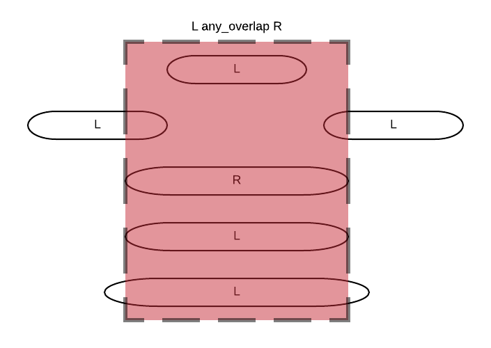

---

**Example 28 - All MIs that overlap with the month of 2010-06**

```JSON

["any_overlap",{"left":["icd9","412"],"right":["date_range",{"start":"2010-06-01","end":"2010-06-30"}]}]

```


| person_id | criterion_id | criterion_table | criterion_domain | start_date | end_date | source_value |
| --------- | ------------ | --------------- | ---------------- | ---------- | -------- | ------------ |
| 110 | 62592 | clinical_codes | condition_occurrence | 2010-06-27 | 2010-06-27 | 412 |
| 217 | 56467 | clinical_codes | condition_occurrence | 2010-06-22 | 2010-06-23 | 412 |

---

### `Before` Operator

Passes along each LHR that ends before the patient's **last** RHR starts: `LHR end_date < latest RHR start_date`. The comparison is strict, so an LHR that ends on the day the RHR starts does not pass.

This rule needs some explanation. Imagine the events A-A-B-A-B-A. How many A's come before a B? One could argue that only the first two A's qualify, because they come before the first B. But three A's come before some B. The `before` operator uses the second answer, so it compares every LHR with the start_date of the patient's last RHR.

---

**Example 29 - All MIs that occurred before a patient's __last__ case of diabetes (250.01)**

```JSON

["before",{"left":["icd9","412"],"right":["icd9","250.01"]}]

```


| person_id | criterion_id | criterion_table | criterion_domain | start_date | end_date | source_value |
| --------- | ------------ | --------------- | ---------------- | ---------- | -------- | ------------ |
| 131 | 172 | clinical_codes | condition_occurrence | 2008-03-22 | 2008-03-23 | 412 |
| 81 | 1405 | clinical_codes | condition_occurrence | 2009-01-28 | 2009-01-30 | 412 |
| 66 | 16171 | clinical_codes | condition_occurrence | 2009-07-25 | 2009-07-25 | 412 |
| 184 | 24281 | clinical_codes | condition_occurrence | 2008-01-07 | 2008-01-07 | 412 |
| 17 | 27269 | clinical_codes | condition_occurrence | 2008-08-25 | 2008-08-25 | 412 |
| 17 | 46165 | clinical_codes | condition_occurrence | 2009-04-30 | 2009-04-30 | 412 |
| 152 | 82988 | clinical_codes | condition_occurrence | 2008-08-16 | 2008-08-16 | 412 |
| 214 | 83257 | clinical_codes | condition_occurrence | 2009-11-12 | 2009-11-12 | 412 |
| 109 | 89334 | clinical_codes | condition_occurrence | 2010-07-06 | 2010-07-06 | 412 |
| 214 | 89463 | clinical_codes | condition_occurrence | 2008-02-17 | 2008-02-17 | 412 |

---

### `After` Operator

Passes along each LHR that starts after the patient's **earliest** RHR end_date: `LHR start_date > earliest RHR end_date`. The comparison is strict.

Imagine the events A-A-B-A-B-A again. How many A's come after a B? One could argue that only the last A qualifies, because it comes after the last B. But two A's come after some B. The `after` operator uses the second answer, so it compares every LHR with the earliest end_date of the patient's RHR.

---

**Example 30 - All MIs that occurred after a patient's __first__ case of diabetes (250.01)**

```JSON

["after",{"left":["icd9","412"],"right":["icd9","250.01"]}]

```


| person_id | criterion_id | criterion_table | criterion_domain | start_date | end_date | source_value |
| --------- | ------------ | --------------- | ---------------- | ---------- | -------- | ------------ |
| 96 | 20748 | clinical_codes | condition_occurrence | 2008-09-21 | 2008-09-24 | 412 |
| 223 | 38682 | clinical_codes | condition_occurrence | 2008-07-28 | 2008-07-28 | 412 |
| 223 | 39893 | clinical_codes | condition_occurrence | 2008-10-31 | 2008-10-31 | 412 |
| 77 | 58165 | clinical_codes | condition_occurrence | 2010-10-06 | 2010-10-06 | 412 |
| 190 | 61423 | clinical_codes | condition_occurrence | 2009-04-09 | 2009-04-09 | 412 |
| 110 | 62592 | clinical_codes | condition_occurrence | 2010-06-27 | 2010-06-27 | 412 |
| 214 | 83257 | clinical_codes | condition_occurrence | 2009-11-12 | 2009-11-12 | 412 |
| 152 | 84298 | clinical_codes | condition_occurrence | 2010-11-22 | 2010-11-22 | 412 |
| 187 | 87583 | clinical_codes | condition_occurrence | 2010-12-26 | 2010-12-26 | 412 |

---

### Working Around `Before`/`After` Behavior

If you want a different RHR for the comparison, use a relative temporal operator to select it:

---

**Example 31 - All MIs that occurred before a patient's __first__ case of diabetes (250.01)**

```JSON

["before",{"left":["icd9","412"],"right":["first",["icd9","250.01"]]}]

```


| person_id | criterion_id | criterion_table | criterion_domain | start_date | end_date | source_value |
| --------- | ------------ | --------------- | ---------------- | ---------- | -------- | ------------ |
| 131 | 172 | clinical_codes | condition_occurrence | 2008-03-22 | 2008-03-23 | 412 |
| 81 | 1405 | clinical_codes | condition_occurrence | 2009-01-28 | 2009-01-30 | 412 |
| 66 | 16171 | clinical_codes | condition_occurrence | 2009-07-25 | 2009-07-25 | 412 |
| 184 | 24281 | clinical_codes | condition_occurrence | 2008-01-07 | 2008-01-07 | 412 |
| 17 | 27269 | clinical_codes | condition_occurrence | 2008-08-25 | 2008-08-25 | 412 |
| 17 | 46165 | clinical_codes | condition_occurrence | 2009-04-30 | 2009-04-30 | 412 |
| 152 | 82988 | clinical_codes | condition_occurrence | 2008-08-16 | 2008-08-16 | 412 |
| 109 | 89334 | clinical_codes | condition_occurrence | 2010-07-06 | 2010-07-06 | 412 |
| 214 | 89463 | clinical_codes | condition_occurrence | 2008-02-17 | 2008-02-17 | 412 |
| 187 | 90638 | clinical_codes | condition_occurrence | 2009-01-31 | 2009-01-31 | 412 |

---

## Time Manipulation Operators

### `Time Window` Operator

Moves the start_date and the end_date of each record. Use it to shift or widen a record's dates before you compare them with other records.

- **Upstream:** one operator.
- **Options:**
  - `start`: how to change the start_date. If you omit it, the start_date does not change.
  - `end`: how to change the end_date. If you omit it, the end_date does not change.

Each option takes a date adjustment, which is one of:

- An amount of time, made of one or more numbers with a unit: `d` (days), `w` (weeks), `m` (months) or `y` (years). Each part can have a `-` or `+` sign. For example:
  - `30d` is 30 days.
  - `20` is 20 days (a bare number means days).
  - `d` is 1 day.
  - `1y` is 1 year.
  - `-1m` is 1 month back.
  - `10d3m` is 3 months and 10 days.
  - `-2y10m-3d` is back 2 years, forward 10 months, and back 3 days.
- `""` or `0`: leave the date unchanged.
- `start` or `end`: use the record's start_date or end_date. See the examples below.
- A date in `YYYY-MM-DD` format: set the date to that date.

---

**Example 32 - All Diagnoses of Diabetes (ICD-9 250.01) within 30 days of an MI**

```JSON

["during",{"left":["icd9","250.01"],"right":["time_window",["icd9","412"],{"start":"-30d","end":"30d"}]}]

```


| person_id | criterion_id | criterion_table | criterion_domain | start_date | end_date | source_value |
| --------- | ------------ | --------------- | ---------------- | ---------- | -------- | ------------ |
| 96 | 46366 | clinical_codes | condition_occurrence | 2008-09-13 | 2008-09-13 | 25001 |
| 223 | 81480 | clinical_codes | condition_occurrence | 2008-07-03 | 2008-07-03 | 25001 |

---

---

**Example 33 - Shift the dates of all MIs back by 200 years**

```JSON

["time_window",["icd9","412"],{"start":"-200y","end":"-200y"}]

```


| person_id | criterion_id | criterion_table | criterion_domain | start_date | end_date | source_value |
| --------- | ------------ | --------------- | ---------------- | ---------- | -------- | ------------ |
| 131 | 172 | clinical_codes | condition_occurrence | 1808-03-22 | 1808-03-23 | 412 |
| 177 | 507 | clinical_codes | condition_occurrence | 1809-06-13 | 1809-06-16 | 412 |
| 230 | 523 | clinical_codes | condition_occurrence | 1808-03-14 | 1808-03-21 | 412 |
| 161 | 963 | clinical_codes | condition_occurrence | 1809-10-25 | 1809-10-29 | 412 |
| 60 | 986 | clinical_codes | condition_occurrence | 1809-07-19 | 1809-07-22 | 412 |
| 81 | 1405 | clinical_codes | condition_occurrence | 1809-01-28 | 1809-01-30 | 412 |
| 88 | 1572 | clinical_codes | condition_occurrence | 1809-01-03 | 1809-01-09 | 412 |
| 213 | 15005 | clinical_codes | condition_occurrence | 1810-02-07 | 1810-02-07 | 412 |
| 66 | 16171 | clinical_codes | condition_occurrence | 1809-07-25 | 1809-07-25 | 412 |
| 220 | 20660 | clinical_codes | condition_occurrence | 1809-10-31 | 1809-10-31 | 412 |

---

---

**Example 34 - Widen the dates of all MIs to run from 2 months and 2 days before the MI to 1 year and 3 days after it**

```JSON

["time_window",["icd9","412"],{"start":"-2m-2d","end":"3d1y"}]

```


| person_id | criterion_id | criterion_table | criterion_domain | start_date | end_date | source_value |
| --------- | ------------ | --------------- | ---------------- | ---------- | -------- | ------------ |
| 131 | 172 | clinical_codes | condition_occurrence | 2008-01-20 | 2009-03-26 | 412 |
| 177 | 507 | clinical_codes | condition_occurrence | 2009-04-11 | 2010-06-19 | 412 |
| 230 | 523 | clinical_codes | condition_occurrence | 2008-01-12 | 2009-03-24 | 412 |
| 161 | 963 | clinical_codes | condition_occurrence | 2009-08-23 | 2010-11-01 | 412 |
| 60 | 986 | clinical_codes | condition_occurrence | 2009-05-17 | 2010-07-25 | 412 |
| 81 | 1405 | clinical_codes | condition_occurrence | 2008-11-26 | 2010-02-02 | 412 |
| 88 | 1572 | clinical_codes | condition_occurrence | 2008-11-01 | 2010-01-12 | 412 |
| 213 | 15005 | clinical_codes | condition_occurrence | 2009-12-05 | 2011-02-10 | 412 |
| 66 | 16171 | clinical_codes | condition_occurrence | 2009-05-23 | 2010-07-28 | 412 |
| 220 | 20660 | clinical_codes | condition_occurrence | 2009-08-29 | 2010-11-03 | 412 |

---

---

**Example 35 - Collapse the date range of all MIs to the start date: leave start_date unchanged and set end_date to start_date**

```JSON

["time_window",["icd9","412"],{"start":"","end":"start"}]

```


| person_id | criterion_id | criterion_table | criterion_domain | start_date | end_date | source_value |
| --------- | ------------ | --------------- | ---------------- | ---------- | -------- | ------------ |
| 131 | 172 | clinical_codes | condition_occurrence | 2008-03-22 | 2008-03-22 | 412 |
| 177 | 507 | clinical_codes | condition_occurrence | 2009-06-13 | 2009-06-13 | 412 |
| 230 | 523 | clinical_codes | condition_occurrence | 2008-03-14 | 2008-03-14 | 412 |
| 161 | 963 | clinical_codes | condition_occurrence | 2009-10-25 | 2009-10-25 | 412 |
| 60 | 986 | clinical_codes | condition_occurrence | 2009-07-19 | 2009-07-19 | 412 |
| 81 | 1405 | clinical_codes | condition_occurrence | 2009-01-28 | 2009-01-28 | 412 |
| 88 | 1572 | clinical_codes | condition_occurrence | 2009-01-03 | 2009-01-03 | 412 |
| 213 | 15005 | clinical_codes | condition_occurrence | 2010-02-07 | 2010-02-07 | 412 |
| 66 | 16171 | clinical_codes | condition_occurrence | 2009-07-25 | 2009-07-25 | 412 |
| 220 | 20660 | clinical_codes | condition_occurrence | 2009-10-31 | 2009-10-31 | 412 |

---

---

**Example 36 - Nonsensical, but allowed: swap the start_date and end_date**

```JSON

["time_window",["icd9","412"],{"start":"end","end":"start"}]

```


| person_id | criterion_id | criterion_table | criterion_domain | start_date | end_date | source_value |
| --------- | ------------ | --------------- | ---------------- | ---------- | -------- | ------------ |
| 131 | 172 | clinical_codes | condition_occurrence | 2008-03-23 | 2008-03-22 | 412 |
| 177 | 507 | clinical_codes | condition_occurrence | 2009-06-16 | 2009-06-13 | 412 |
| 230 | 523 | clinical_codes | condition_occurrence | 2008-03-21 | 2008-03-14 | 412 |
| 161 | 963 | clinical_codes | condition_occurrence | 2009-10-29 | 2009-10-25 | 412 |
| 60 | 986 | clinical_codes | condition_occurrence | 2009-07-22 | 2009-07-19 | 412 |
| 81 | 1405 | clinical_codes | condition_occurrence | 2009-01-30 | 2009-01-28 | 412 |
| 88 | 1572 | clinical_codes | condition_occurrence | 2009-01-09 | 2009-01-03 | 412 |
| 213 | 15005 | clinical_codes | condition_occurrence | 2010-02-07 | 2010-02-07 | 412 |
| 66 | 16171 | clinical_codes | condition_occurrence | 2009-07-25 | 2009-07-25 | 412 |
| 220 | 20660 | clinical_codes | condition_occurrence | 2009-10-31 | 2009-10-31 | 412 |

---

### `Trim Date Start` Operator

Moves the start_date of each LHR forward to the end_date of an RHR. Like a [temporal comparison operator](#temporal-comparison-operators), it takes left-hand and right-hand streams and compares each patient's records.

- **Options:** `left` (required), `right` (required), and `within` (a date adjustment that is added to the RHR end_date before the comparison).
- For each patient, it uses the end_date of the RHR with the latest start_date.

There are four cases:

- The patient has no RHR.
  - The LHR passes through unchanged.
- The RHR end_date is before the LHR start_date.
  - The LHR passes through unchanged.
- The RHR end_date is after the LHR end_date.
  - The LHR is discarded.
- The RHR end_date is between the LHR start_date and end_date.
  - The LHR's start_date becomes the RHR's end_date.

---

**Example 37 - Each patient's span from birth to age 50, trimmed to start no earlier than 1980-01-01 (patients who were 50 before 1980 are dropped)**

```JSON

["trim_date_start",{"left":["time_window",["person"],{"end":"+50y"}],"right":["date_range",{"start":"1980-01-01","end":"1980-01-01"}]}]

```


| person_id | criterion_id | criterion_table | criterion_domain | start_date | end_date | source_value |
| --------- | ------------ | --------------- | ---------------- | ---------- | -------- | ------------ |
| 2 | 2 | patients | person | 1980-01-01 | 1993-01-01 | 00016F745862898F |
| 3 | 3 | patients | person | 1980-01-01 | 1986-09-01 | 0001FDD721E223DC |
| 4 | 4 | patients | person | 1980-01-01 | 1991-06-01 | 00021CA6FF03E670 |
| 5 | 5 | patients | person | 1980-01-01 | 1986-08-01 | 00024B3D2352D2D0 |
| 6 | 6 | patients | person | 1980-01-01 | 1993-10-01 | 0002DAE1C81CC70D |
| 8 | 8 | patients | person | 1980-01-01 | 1985-09-01 | 000308435E3E5B76 |
| 9 | 9 | patients | person | 1980-01-01 | 2026-09-01 | 000345A39D4157C9 |
| 10 | 10 | patients | person | 1980-01-01 | 1988-10-01 | 00036A21B65B0206 |
| 11 | 11 | patients | person | 1980-01-01 | 1984-02-01 | 000489E7EAAD463F |
| 13 | 13 | patients | person | 1980-01-01 | 1986-07-01 | 0004F0ABD505251D |

---

### `Trim Date End` Operator

Moves the end_date of each LHR back to the start_date of an RHR. Like a [temporal comparison operator](#temporal-comparison-operators), it takes left-hand and right-hand streams and compares each patient's records.

- **Options:** `left` (required), `right` (required), and `within` (a date adjustment that is subtracted from the RHR start_date before the comparison).
- For each patient, it uses the earliest RHR start_date.

There are four cases:

- The patient has no RHR.
  - The LHR passes through unchanged.
- The RHR start_date is after the LHR end_date.
  - The LHR passes through unchanged.
- The RHR start_date is before the LHR start_date.
  - The LHR is discarded.
- The RHR start_date is between the LHR start_date and end_date.
  - The LHR's end_date becomes the RHR's start_date.

---

**Example 38 - Each patient's span from birth to age 50 or to 1980-01-01, whichever is earlier (patients born after 1980 are dropped)**

```JSON

["trim_date_end",{"left":["time_window",["person"],{"end":"+50y"}],"right":["date_range",{"start":"1980-01-01","end":"1980-01-01"}]}]

```


| person_id | criterion_id | criterion_table | criterion_domain | start_date | end_date | source_value |
| --------- | ------------ | --------------- | ---------------- | ---------- | -------- | ------------ |
| 1 | 1 | patients | person | 1923-05-01 | 1973-05-01 | 00013D2EFD8E45D1 |
| 2 | 2 | patients | person | 1943-01-01 | 1980-01-01 | 00016F745862898F |
| 3 | 3 | patients | person | 1936-09-01 | 1980-01-01 | 0001FDD721E223DC |
| 4 | 4 | patients | person | 1941-06-01 | 1980-01-01 | 00021CA6FF03E670 |
| 5 | 5 | patients | person | 1936-08-01 | 1980-01-01 | 00024B3D2352D2D0 |
| 6 | 6 | patients | person | 1943-10-01 | 1980-01-01 | 0002DAE1C81CC70D |
| 7 | 7 | patients | person | 1922-07-01 | 1972-07-01 | 0002F28CE057345B |
| 8 | 8 | patients | person | 1935-09-01 | 1980-01-01 | 000308435E3E5B76 |
| 9 | 9 | patients | person | 1976-09-01 | 1980-01-01 | 000345A39D4157C9 |
| 10 | 10 | patients | person | 1938-10-01 | 1980-01-01 | 00036A21B65B0206 |

---

## Temporal Comparison Operator Options

It can be hard to reason with [`time_window`](#time-window-operator) when you use temporal comparison operators. These options describe some common temporal relationships more directly:

- `within` (all temporal comparison operators): a date adjustment, such as `30d`, `2m` or `1y-3d`.
  - `before`: the LHR must also end no earlier than `within` before the RHR start_date.
  - `after`: the LHR must also start no later than `within` after the RHR end_date.
  - `during` and `any_overlap`: the RHR date range is widened by `within` in each direction before the comparison.
  - `contains`: the LHR date range is widened by `within` in each direction before the comparison.
- `at_least` (`before` and `after` only): a date adjustment.
  - `before`: the LHR must end more than `at_least` before the RHR start_date.
  - `after`: the LHR must start more than `at_least` after the RHR end_date.

Use positive amounts with these options.

When `before` or `after` has the `within` option, it compares each LHR with every RHR of the patient, not only with the patient's last or earliest RHR.

Here are the options in use:

**Prescriptions After an Office Visit** - Find all prescriptions of interest that occur within three days after an office visit

---

**Example 39**

```JSON

["after",{"left":["ndc","61392070054","65084025214","65726040125",{"label":"Prescriptions of Interest"}],"right":["cpt","99214",{"label":"Office Visit"}],"within":"3d"}]

```


| person_id | criterion_id | criterion_table | criterion_domain | start_date | end_date | source_value |
| --------- | ------------ | --------------- | ---------------- | ---------- | -------- | ------------ |
| 207 | 11312 | clinical_codes | drug_exposure | 2010-08-13 | 2010-08-13 | 61392070054 |

---

Walk-through of the example above:

- Select some prescriptions of interest as the LHR.
- Select office visits as the RHR.
- Compare each LHR with each RHR of the same patient. Keep the LHR whose start_date is after the RHR end_date, and no more than 3 days after it.

**Find all Heart Attacks Probably Resulting in Death** - Does anyone die within a year of a heart attack?

---

**Example 40**

```JSON

["before",{"left":["icd9","410.00","410.01","410.10","410.11"],"right":["death"],"within":"1y"}]

```


| person_id | criterion_id | criterion_table | criterion_domain | start_date | end_date | source_value |
| --------- | ------------ | --------------- | ---------------- | ---------- | -------- | ------------ |
| 191 | 42977 | clinical_codes | condition_occurrence | 2009-05-21 | 2009-05-21 | 41010 |

---

Walk-through of the example above:

- Select heart attack diagnoses as the LHR.
- Select death records as the RHR.
- Keep the LHR whose end_date is before the date of death, and no more than 1 year before it.

---

**Example 41 - Find all diagnoses of heart attack more than 1 week after a diagnosis of diabetes**

```JSON

["after",{"left":["icd9","410.00","410.01","410.10","410.11",{"label":"Heart Attack Dx"}],"right":["icd9","250.01",{"label":"Diabetes Dx"}],"at_least":"1w"}]

```


| person_id | criterion_id | criterion_table | criterion_domain | start_date | end_date | source_value |
| --------- | ------------ | --------------- | ---------------- | ---------- | -------- | ------------ |
| 58 | 79480 | clinical_codes | condition_occurrence | 2009-02-24 | 2009-02-24 | 41011 |

---

This example shows how `at_least` works.

### Temporal Operators and Person Streams

The start and end dates of a person record are the patient's birth date. So a person stream is rarely useful as the left-hand stream of a temporal operator. But it is useful as the right-hand stream. If we move the birth date with `time_window`, we can filter by the patient's age:

---

**Example 42 - All MIs that occurred after a male patient's 50th birthday**

```JSON

["after",{"left":["icd9","412"],"right":["time_window",["gender","Male"],{"start":"50y","end":"50y"}]}]

```


| person_id | criterion_id | criterion_table | criterion_domain | start_date | end_date | source_value |
| --------- | ------------ | --------------- | ---------------- | ---------- | -------- | ------------ |
| 190 | 61423 | clinical_codes | condition_occurrence | 2009-04-09 | 2009-04-09 | 412 |
| 60 | 986 | clinical_codes | condition_occurrence | 2009-07-19 | 2009-07-22 | 412 |
| 197 | 21914 | clinical_codes | condition_occurrence | 2009-05-07 | 2009-05-07 | 412 |
| 149 | 28518 | clinical_codes | condition_occurrence | 2008-04-07 | 2008-04-07 | 412 |
| 239 | 49718 | clinical_codes | condition_occurrence | 2010-02-12 | 2010-02-12 | 412 |
| 239 | 47130 | clinical_codes | condition_occurrence | 2009-08-04 | 2009-08-04 | 412 |
| 161 | 963 | clinical_codes | condition_occurrence | 2009-10-25 | 2009-10-29 | 412 |
| 214 | 89463 | clinical_codes | condition_occurrence | 2008-02-17 | 2008-02-17 | 412 |
| 214 | 83257 | clinical_codes | condition_occurrence | 2009-11-12 | 2009-11-12 | 412 |
| 187 | 90638 | clinical_codes | condition_occurrence | 2009-01-31 | 2009-01-31 | 412 |

---

## `Episode` Operator

Merges each patient's records into episodes: spans of time in which the records are close together. For example, it can turn a set of prescriptions into the spans of time in which we consider a patient to be taking a drug.

- **Upstream:** one operator.
- **Options:**
  - `gap_of` (integer number of days, default 0): the largest gap between the end of one record and the start of the next that stays in the same episode.
- **Returns:** one record for each episode. Its start_date is the earliest start_date in the episode, and its end_date is the latest end_date.

---

**Example 43 - Episodes of diabetes diagnoses**

```JSON

["episode",["icd9","250.00"],{"gap_of":"90"}]

```


| person_id | criterion_id | criterion_table | criterion_domain | start_date | end_date | source_value |
| --------- | ------------ | --------------- | ---------------- | ---------- | -------- | ------------ |
| 2 | 0 | episode | episode | 2009-05-11 | 2009-07-31 |  |
| 3 | 0 | episode | episode | 2009-11-17 | 2009-11-17 |  |
| 5 | 0 | episode | episode | 2009-06-28 | 2009-06-28 |  |
| 7 | 0 | episode | episode | 2008-04-23 | 2008-06-09 |  |
| 7 | 0 | episode | episode | 2008-10-02 | 2008-11-30 |  |
| 7 | 0 | episode | episode | 2009-07-12 | 2009-09-13 |  |
| 7 | 0 | episode | episode | 2010-04-22 | 2010-07-18 |  |
| 8 | 0 | episode | episode | 2008-10-17 | 2008-10-17 |  |
| 8 | 0 | episode | episode | 2009-03-01 | 2009-03-03 |  |
| 8 | 0 | episode | episode | 2009-07-16 | 2009-07-16 |  |

---

An episode record does not point back to one row, because it merges several records. Its `criterion_table` and `criterion_domain` are `episode`, and its `criterion_id` is 0. An episode stream is often most useful as the right-hand stream of a [temporal operator](#temporal-comparison-operators).

# Inline-Filter Operators

These operators filter one incoming stream and pass along the records that remain.

## `Place of Service Filter` Operator

Claims often report the place of service of an event with a CMS place of service code, such as "inpatient hospital" (21) or "outpatient hospital" (22). The `place_of_service_filter` operator keeps the records whose claim has one of the given place of service codes.

- **Arguments:** one or more CMS place of service codes, such as `21` or `22`. `*` keeps every record that has a place of service. An unknown code makes the statement invalid.
- **Upstream:** one operator.

---

**Example 44**

```JSON

["place_of_service_filter",22,["icd9","250.00"]]

```


```No Results found.```

---

Our test data has no place of service information, so this example returns no records.

## `Provenance` Operator

Provenance is information about the origin of claims data. It is sometimes an important factor in research algorithms. For example, authors often describe "inpatient records", by which they mean claims from the inpatient file of a claims dataset. The [GDM](https://github.com/outcomesinsights/generalized_data_model#contexts) records the provenance of the data during ETL. The `provenance` operator keeps the records that have the given provenance.

- **Arguments:** one or more provenance keywords, in lower case. Case matters.
- **Upstream:** one operator.

There are two kinds of keyword:

- A file keyword says which kind of file a record came from: `inpatient`, `outpatient`, `carrier_claim`, `claim`, `dme`, `hha`, `hospice`, `snf`, `prescription_drug` or `demographics`.
- A code keyword says where the code was in the claim: `primary`, `primary_or_first`, `first`, `second`, `admitting`, `discharge`, `problem_list`, `chief_complaint` or `unspecified`.

A keyword also includes the provenances under it. For example, `inpatient` includes `snf`, `outpatient` includes `hha` and `hospice`, and `claim` includes every kind of claim file.

- A record passes if it matches any of the keywords.
- The form `file:code`, such as `inpatient:primary`, requires both the file provenance and the code provenance.
- `*` keeps every record that has a provenance.
- A statement with no keyword, or with an unknown keyword, is invalid.

---

**Example 45**

```JSON

["provenance","inpatient",["icd9","250.00"]]

```


| person_id | criterion_id | criterion_table | criterion_domain | start_date | end_date | source_value |
| --------- | ------------ | --------------- | ---------------- | ---------- | -------- | ------------ |
| 131 | 170 | clinical_codes | condition_occurrence | 2008-03-22 | 2008-03-23 | 25000 |
| 243 | 205 | clinical_codes | condition_occurrence | 2009-08-20 | 2009-08-23 | 25000 |
| 230 | 231 | clinical_codes | condition_occurrence | 2008-03-30 | 2008-04-02 | 25000 |
| 32 | 257 | clinical_codes | condition_occurrence | 2010-08-30 | 2010-09-07 | 25000 |
| 79 | 267 | clinical_codes | condition_occurrence | 2009-08-09 | 2009-08-24 | 25000 |
| 230 | 284 | clinical_codes | condition_occurrence | 2008-03-01 | 2008-03-06 | 25000 |
| 168 | 297 | clinical_codes | condition_occurrence | 2010-02-14 | 2010-02-18 | 25000 |
| 247 | 337 | clinical_codes | condition_occurrence | 2008-03-29 | 2008-03-30 | 25000 |
| 247 | 351 | clinical_codes | condition_occurrence | 2008-02-07 | 2008-02-10 | 25000 |
| 177 | 504 | clinical_codes | condition_occurrence | 2009-06-13 | 2009-06-16 | 25000 |

---

## `Provider Filter` Operator

Keeps the records in which a particular kind of provider took part.

- **Upstream:** one operator.
- **Options:** both are required.
  - `specialties`: the specialty of the provider. A record passes if the practitioner's own specialty, or the specialty recorded for the practitioner on that record's claim, matches.
  - `roles`: the role that the provider had, from the GDM_ROLE vocabulary. For example, `100000066` (Performing physician), `100000067` (Attending physician), `100000068` (Operating physician), `100000069` (Other physician), `100176860` (Billing provider), `100176861` (Rendering provider) and `100176862` (Prescribing provider).
- **Returns:** the matching records, with the columns `provider_id`, `context_specialty_concept_id`, `practitioner_specialty_concept_id` and `role_type_concept_id` added.

Each option takes a comma-separated list of concept IDs, and a record passes if it matches any of them. Use `*` to skip that half of the filter. For example, `{ "specialties": "*", "roles": "100000067" }` keeps the records that had an attending physician of any specialty. One record can involve several providers, so a record can appear more than once if more than one of its providers matches.

The operator takes concept IDs, not names of specialties and roles.

This example looks for diabetes diagnoses whose attending physician was an endocrinologist. `38003868` is the NUCC specialty "Endocrinology, Diabetes & Metabolism Physician", and `100000067` is the "Attending physician" role. The results show every column, so you can see the provider, both specialty columns, and the role that matched:

---

**Example 46 - Diabetes diagnoses with an endocrinologist as the attending physician**

```JSON

["provider_filter",["icd9","250.00"],{"specialties":"38003868","roles":"100000067"}]

```


| person_id | criterion_id | criterion_table | criterion_domain | start_date | end_date | source_value | source_vocabulary_id | label | column_family | provider_id | context_specialty_concept_id | practitioner_specialty_concept_id | role_type_concept_id |
| --------- | ------------ | --------------- | ---------------- | ---------- | -------- | ------------ | -------------------- | ----- | ------------- | ----------- | ---------------------------- | --------------------------------- | -------------------- |
| 17 | 18184 | clinical_codes | condition_occurrence | 2010-08-22 | 2010-08-22 | 25000 | ICD9CM |  | default | 6856 | 38003868 |  | 100000067 |

---

## `One In Two Out` Operator

Algorithms often consider a condition to be confirmed if:

- the condition appears once in an inpatient record, or
- the condition appears twice in outpatient records, separated by a minimum gap (often 30 days).

The `one_in_two_out` operator implements this pattern.

---

**Example 47 - First diabetes diagnosis, either found once in an inpatient record, or twice in outpatient records at least 30 days apart**

```JSON

["one_in_two_out",["icd9","250.00"],{"outpatient_minimum_gap":"30d","outpatient_event_to_return":"Initial Event"}]

```


| person_id | criterion_id | criterion_table | criterion_domain | start_date | end_date | source_value |
| --------- | ------------ | --------------- | ---------------- | ---------- | -------- | ------------ |
| 2 | 89752 | clinical_codes | condition_occurrence | 2009-05-11 | 2009-05-11 | 25000 |
| 7 | 15942 | clinical_codes | condition_occurrence | 2008-04-23 | 2008-04-23 | 25000 |
| 8 | 95135 | clinical_codes | condition_occurrence | 2008-10-17 | 2008-10-17 | 25000 |
| 9 | 24929 | clinical_codes | condition_occurrence | 2010-08-01 | 2010-08-01 | 25000 |
| 11 | 73103 | clinical_codes | condition_occurrence | 2008-06-17 | 2008-06-17 | 25000 |
| 12 | 15443 | clinical_codes | condition_occurrence | 2009-04-20 | 2009-04-20 | 25000 |
| 13 | 19968 | clinical_codes | condition_occurrence | 2008-03-05 | 2008-03-05 | 25000 |
| 14 | 77991 | clinical_codes | condition_occurrence | 2009-06-05 | 2009-06-05 | 25000 |
| 15 | 47045 | clinical_codes | condition_occurrence | 2008-09-24 | 2008-09-24 | 25000 |
| 17 | 83187 | clinical_codes | condition_occurrence | 2008-04-14 | 2008-04-14 | 25000 |

---

- **Upstream:** one operator.
- **Returns:** one record per patient: the earliest confirmed event.

The operator decides between inpatient and outpatient by the provenance of each record (see [`provenance`](#provenance-operator)):

- A record with `inpatient` provenance (which includes SNF) is an inpatient record.
- A record with `outpatient` or `carrier_claim` provenance is an outpatient record.
- Other records, and records whose type is not `condition_occurrence`, are removed.

The place of service of a record does not matter. The two outpatient records need not have the same code. Any two records from the upstream stream can confirm each other.

For an inpatient record, the operator uses the admission date and the discharge date of its admission, when the claim has them. It returns an inpatient record with the admission date as its start_date and the discharge date as its end_date. For outpatient records, it compares start_dates.

Options:

- `inpatient_length_of_stay` (Inpatient Length of Stay): an integer number of days, default 0.
  - An inpatient record counts only if its discharge date is more than this many days after its admission date.
  - 0 or empty means no length-of-stay check.
- `outpatient_minimum_gap` (Outpatient Minimum Gap): a date adjustment, as in `time_window` (for example `30d`, `1m` or `1y`).
  - The confirming outpatient record must start at least this long after the initial record.
  - If you omit it, the gap is 30 days.
- `outpatient_maximum_gap` (Outpatient Maximum Gap): a date adjustment.
  - The confirming outpatient record must start no more than this long after the initial record.
  - If you omit it, there is no maximum. Jigsaw fills in 365 days.
  - This option helps with acute diseases. For example, to confirm the flu, set a maximum gap so that the two diagnoses come from the same illness.
- `outpatient_event_to_return` (Outpatient Event to Return): `Initial Event` or `Confirming Event`.
  - It chooses which outpatient record to return when two outpatient records confirm the condition.
  - Use `Initial Event` in most cases, for example when the algorithm records an exposure of interest or an outcome.
  - Use `Confirming Event` when the algorithm finds an index event. The initial event would introduce immortal time bias.
  - Jigsaw fills in `Initial Event`. A statement that omits the option, or gives any other value, gets `Confirming Event`. So always set this option.

## `Person Filter` Operator

Keeps each left-hand record whose patient appears anywhere in the right-hand stream. For example, to find all MIs of males, use `person_filter`.

- **Options:** `left` (required) and `right` (required), each an operator.
- **Returns:** the left-hand records of every type whose patient has at least one right-hand record. The type and the dates of the right-hand records do not matter.

---

**Example 48 - All MI Conditions for people who are male**

```JSON

["person_filter",{"left":["icd9","412"],"right":["gender","Male"]}]

```


| person_id | criterion_id | criterion_table | criterion_domain | start_date | end_date | source_value |
| --------- | ------------ | --------------- | ---------------- | ---------- | -------- | ------------ |
| 190 | 61423 | clinical_codes | condition_occurrence | 2009-04-09 | 2009-04-09 | 412 |
| 60 | 986 | clinical_codes | condition_occurrence | 2009-07-19 | 2009-07-22 | 412 |
| 197 | 21914 | clinical_codes | condition_occurrence | 2009-05-07 | 2009-05-07 | 412 |
| 149 | 28518 | clinical_codes | condition_occurrence | 2008-04-07 | 2008-04-07 | 412 |
| 239 | 49718 | clinical_codes | condition_occurrence | 2010-02-12 | 2010-02-12 | 412 |
| 239 | 47130 | clinical_codes | condition_occurrence | 2009-08-04 | 2009-08-04 | 412 |
| 161 | 963 | clinical_codes | condition_occurrence | 2009-10-25 | 2009-10-29 | 412 |
| 214 | 89463 | clinical_codes | condition_occurrence | 2008-02-17 | 2008-02-17 | 412 |
| 214 | 83257 | clinical_codes | condition_occurrence | 2009-11-12 | 2009-11-12 | 412 |
| 187 | 90638 | clinical_codes | condition_occurrence | 2009-01-31 | 2009-01-31 | 412 |

---

The right-hand stream need not be a person stream. Any record of a patient counts:

---

**Example 49 - All MI Conditions for people who had an office visit at some point in the data**

```JSON

["person_filter",{"left":["icd9","412"],"right":["cpt","99214"]}]

```


| person_id | criterion_id | criterion_table | criterion_domain | start_date | end_date | source_value |
| --------- | ------------ | --------------- | ---------------- | ---------- | -------- | ------------ |
| 184 | 24281 | clinical_codes | condition_occurrence | 2008-01-07 | 2008-01-07 | 412 |
| 190 | 61423 | clinical_codes | condition_occurrence | 2009-04-09 | 2009-04-09 | 412 |
| 60 | 986 | clinical_codes | condition_occurrence | 2009-07-19 | 2009-07-22 | 412 |
| 197 | 21914 | clinical_codes | condition_occurrence | 2009-05-07 | 2009-05-07 | 412 |
| 149 | 28518 | clinical_codes | condition_occurrence | 2008-04-07 | 2008-04-07 | 412 |
| 73 | 52843 | clinical_codes | condition_occurrence | 2008-11-16 | 2008-11-16 | 412 |
| 11 | 82614 | clinical_codes | condition_occurrence | 2008-10-29 | 2008-10-29 | 412 |
| 161 | 963 | clinical_codes | condition_occurrence | 2009-10-25 | 2009-10-29 | 412 |
| 239 | 49718 | clinical_codes | condition_occurrence | 2010-02-12 | 2010-02-12 | 412 |
| 239 | 47130 | clinical_codes | condition_occurrence | 2009-08-04 | 2009-08-04 | 412 |

---

---

**Example 50 - The same result as the example above, with the office visits converted to patients first**

```JSON

["person_filter",{"left":["icd9","412"],"right":["person",["cpt","99214"]]}]

```


| person_id | criterion_id | criterion_table | criterion_domain | start_date | end_date | source_value |
| --------- | ------------ | --------------- | ---------------- | ---------- | -------- | ------------ |
| 131 | 172 | clinical_codes | condition_occurrence | 2008-03-22 | 2008-03-23 | 412 |
| 177 | 507 | clinical_codes | condition_occurrence | 2009-06-13 | 2009-06-16 | 412 |
| 230 | 523 | clinical_codes | condition_occurrence | 2008-03-14 | 2008-03-21 | 412 |
| 161 | 963 | clinical_codes | condition_occurrence | 2009-10-25 | 2009-10-29 | 412 |
| 60 | 986 | clinical_codes | condition_occurrence | 2009-07-19 | 2009-07-22 | 412 |
| 81 | 1405 | clinical_codes | condition_occurrence | 2009-01-28 | 2009-01-30 | 412 |
| 88 | 1572 | clinical_codes | condition_occurrence | 2009-01-03 | 2009-01-09 | 412 |
| 66 | 16171 | clinical_codes | condition_occurrence | 2009-07-25 | 2009-07-25 | 412 |
| 220 | 20660 | clinical_codes | condition_occurrence | 2009-10-31 | 2009-10-31 | 412 |
| 96 | 20748 | clinical_codes | condition_occurrence | 2008-09-21 | 2008-09-24 | 412 |

---

---

**Example 51 - All MI Conditions for people who are Male OR had an office visit at some point in the data**

```JSON

["person_filter",{"left":["icd9","412"],"right":["union",["cpt","99214"],["gender","Male"]]}]

```


| person_id | criterion_id | criterion_table | criterion_domain | start_date | end_date | source_value |
| --------- | ------------ | --------------- | ---------------- | ---------- | -------- | ------------ |
| 234 | 22299 | clinical_codes | condition_occurrence | 2008-09-01 | 2008-09-01 | 412 |
| 177 | 48526 | clinical_codes | condition_occurrence | 2008-09-23 | 2008-09-23 | 412 |
| 177 | 507 | clinical_codes | condition_occurrence | 2009-06-13 | 2009-06-16 | 412 |
| 106 | 29318 | clinical_codes | condition_occurrence | 2009-02-27 | 2009-02-27 | 412 |
| 110 | 62592 | clinical_codes | condition_occurrence | 2010-06-27 | 2010-06-27 | 412 |
| 184 | 24281 | clinical_codes | condition_occurrence | 2008-01-07 | 2008-01-07 | 412 |
| 190 | 61423 | clinical_codes | condition_occurrence | 2009-04-09 | 2009-04-09 | 412 |
| 60 | 986 | clinical_codes | condition_occurrence | 2009-07-19 | 2009-07-22 | 412 |
| 197 | 21914 | clinical_codes | condition_occurrence | 2009-05-07 | 2009-05-07 | 412 |
| 149 | 28518 | clinical_codes | condition_occurrence | 2008-04-07 | 2008-04-07 | 412 |

---

The left-hand stream can also have several types:

---

**Example 52 - Yields two types: all MI Conditions for people who are Male, and all office visit Procedures for people who are Male**

```JSON

["person_filter",{"left":["union",["icd9","412"],["cpt","99214"]],"right":["gender","Male"]}]

```


| person_id | criterion_id | criterion_table | criterion_domain | start_date | end_date | source_value |
| --------- | ------------ | --------------- | ---------------- | ---------- | -------- | ------------ |
| 131 | 172 | clinical_codes | condition_occurrence | 2008-03-22 | 2008-03-23 | 412 |
| 230 | 523 | clinical_codes | condition_occurrence | 2008-03-14 | 2008-03-21 | 412 |
| 161 | 963 | clinical_codes | condition_occurrence | 2009-10-25 | 2009-10-29 | 412 |
| 60 | 986 | clinical_codes | condition_occurrence | 2009-07-19 | 2009-07-22 | 412 |
| 213 | 15005 | clinical_codes | condition_occurrence | 2010-02-07 | 2010-02-07 | 412 |
| 220 | 20660 | clinical_codes | condition_occurrence | 2009-10-31 | 2009-10-31 | 412 |
| 96 | 20748 | clinical_codes | condition_occurrence | 2008-09-21 | 2008-09-24 | 412 |
| 197 | 21914 | clinical_codes | condition_occurrence | 2009-05-07 | 2009-05-07 | 412 |
| 149 | 28518 | clinical_codes | condition_occurrence | 2008-04-07 | 2008-04-07 | 412 |
| 212 | 34051 | clinical_codes | condition_occurrence | 2009-10-07 | 2009-10-07 | 412 |

---

# Comparison Operators

These operators compare records of incoming streams to produce a set of records.

## `Filter` Operator

Keeps each left-hand record that also appears in the right-hand stream. It is an intersection of the two streams.

- **Options:** `left` (required) and `right` (required), each an operator.
- **Returns:** the left-hand records that have a right-hand record with the same `person_id`, `criterion_id`, `criterion_table`, `criterion_domain`, `start_date` and `end_date`.

Filter compares records, not date ranges. A record whose dates `time_window` changed no longer matches the original record.

## `Match` Operator

Keeps each left-hand record that is equal to a right-hand record in every column, including `label`. Two empty (NULL) values count as equal. It is stricter than [`filter`](#filter-operator), so most users want `filter`. Systems that build statements, such as Jigsaw's export engine, use match with options that Jigsaw does not show.

- **Options:** `left` (required) and `right` (required), each an operator.

## `Co-Reported` Operator

Claims data often reports diagnoses on the same claim as a procedure. This is done for billing: the provider says "I performed this procedure because the patient has these conditions". The `co_reported` operator finds this relationship.

- **Upstream:** two or more operators.
- **Returns:** the records of every stream that were reported in the same claim as a record of every other stream. In the [GDM](https://github.com/outcomesinsights/generalized_data_model), "the same claim" means the same [context](https://github.com/outcomesinsights/generalized_data_model#contexts).

The operator does not compare dates. If one stream has no record in a context, the records of all streams in that context are dropped. Person and death records have no context, so they never pass.

---

**Example 53 - Diabetes diagnoses reported as a reason for an office visit, and those office visits**

```JSON

["co_reported",["icd9","250.00"],["cpt","99214"]]

```


| person_id | criterion_id | criterion_table | criterion_domain | start_date | end_date | source_value |
| --------- | ------------ | --------------- | ---------------- | ---------- | -------- | ------------ |
| 202 | 38757 | clinical_codes | procedure_occurrence | 2010-07-21 | 2010-07-21 | 99214 |
| 61 | 54188 | clinical_codes | procedure_occurrence | 2010-01-14 | 2010-01-23 | 99214 |
| 96 | 77076 | clinical_codes | condition_occurrence | 2008-03-28 | 2008-03-28 | 25000 |
| 178 | 84288 | clinical_codes | procedure_occurrence | 2008-10-26 | 2008-10-26 | 99214 |
| 161 | 83260 | clinical_codes | condition_occurrence | 2008-09-30 | 2008-09-30 | 25000 |
| 247 | 62385 | clinical_codes | condition_occurrence | 2008-06-28 | 2008-06-28 | 25000 |
| 187 | 33423 | clinical_codes | condition_occurrence | 2010-09-10 | 2010-09-10 | 25000 |
| 208 | 78854 | clinical_codes | procedure_occurrence | 2009-05-27 | 2009-05-27 | 99214 |
| 131 | 70430 | clinical_codes | condition_occurrence | 2009-11-02 | 2009-11-02 | 25000 |
| 243 | 35845 | clinical_codes | procedure_occurrence | 2008-10-09 | 2008-10-09 | 99214 |

---

Both the diagnoses and the procedures pass through the operator.

# `label` Option and Its Features

Every ConceptQL operator takes a `label` option. A label is a short description of an operator, usually of the records that it produces.

An operator with a `label` writes its label into the `label` column of its records. An operator without a label passes the upstream label through.

For example, here are some diabetes diagnoses with a label:

---

**Example 54**

```JSON

["icd9","250.00",{"label":"diabetes"}]

```


| person_id | criterion_id | criterion_table | criterion_domain | start_date | end_date | source_value | source_vocabulary_id | label | column_family |
| --------- | ------------ | --------------- | ---------------- | ---------- | -------- | ------------ | -------------------- | ----- | ------------- |
| 131 | 170 | clinical_codes | condition_occurrence | 2008-03-22 | 2008-03-23 | 25000 | ICD9CM | diabetes | default |
| 243 | 205 | clinical_codes | condition_occurrence | 2009-08-20 | 2009-08-23 | 25000 | ICD9CM | diabetes | default |
| 230 | 231 | clinical_codes | condition_occurrence | 2008-03-30 | 2008-04-02 | 25000 | ICD9CM | diabetes | default |
| 32 | 257 | clinical_codes | condition_occurrence | 2010-08-30 | 2010-09-07 | 25000 | ICD9CM | diabetes | default |
| 79 | 267 | clinical_codes | condition_occurrence | 2009-08-09 | 2009-08-24 | 25000 | ICD9CM | diabetes | default |
| 230 | 284 | clinical_codes | condition_occurrence | 2008-03-01 | 2008-03-06 | 25000 | ICD9CM | diabetes | default |
| 168 | 297 | clinical_codes | condition_occurrence | 2010-02-14 | 2010-02-18 | 25000 | ICD9CM | diabetes | default |
| 247 | 337 | clinical_codes | condition_occurrence | 2008-03-29 | 2008-03-30 | 25000 | ICD9CM | diabetes | default |
| 247 | 351 | clinical_codes | condition_occurrence | 2008-02-07 | 2008-02-10 | 25000 | ICD9CM | diabetes | default |
| 177 | 504 | clinical_codes | condition_occurrence | 2009-06-13 | 2009-06-16 | 25000 | ICD9CM | diabetes | default |

---

The label of the nearest labeled operator is the one in the output:

---

**Example 55**

```JSON

["first",["icd9","250.00",{"label":"won't show"}],{"label":"1st diabetes"}]

```


| person_id | criterion_id | criterion_table | criterion_domain | start_date | end_date | source_value | source_vocabulary_id | label | column_family |
| --------- | ------------ | --------------- | ---------------- | ---------- | -------- | ------------ | -------------------- | ----- | ------------- |
| 2 | 89752 | clinical_codes | condition_occurrence | 2009-05-11 | 2009-05-11 | 25000 | ICD9CM | 1st diabetes | default |
| 3 | 93400 | clinical_codes | condition_occurrence | 2009-11-17 | 2009-11-17 | 25000 | ICD9CM | 1st diabetes | default |
| 5 | 89717 | clinical_codes | condition_occurrence | 2009-06-28 | 2009-06-28 | 25000 | ICD9CM | 1st diabetes | default |
| 7 | 15942 | clinical_codes | condition_occurrence | 2008-04-23 | 2008-04-23 | 25000 | ICD9CM | 1st diabetes | default |
| 8 | 95135 | clinical_codes | condition_occurrence | 2008-10-17 | 2008-10-17 | 25000 | ICD9CM | 1st diabetes | default |
| 9 | 24929 | clinical_codes | condition_occurrence | 2010-08-01 | 2010-08-01 | 25000 | ICD9CM | 1st diabetes | default |
| 11 | 73103 | clinical_codes | condition_occurrence | 2008-06-17 | 2008-06-17 | 25000 | ICD9CM | 1st diabetes | default |
| 12 | 15443 | clinical_codes | condition_occurrence | 2009-04-20 | 2009-04-20 | 25000 | ICD9CM | 1st diabetes | default |
| 13 | 19968 | clinical_codes | condition_occurrence | 2008-03-05 | 2008-03-05 | 25000 | ICD9CM | 1st diabetes | default |
| 14 | 77991 | clinical_codes | condition_occurrence | 2009-06-05 | 2009-06-05 | 25000 | ICD9CM | 1st diabetes | default |

---

Labels give hints about the output:

---

**Example 56**

```JSON

["first",["union",["icd9","250.00",{"label":"diabetes"}],["icd9","401.9",{"label":"hypertension"}]]]

```


| person_id | criterion_id | criterion_table | criterion_domain | start_date | end_date | source_value | source_vocabulary_id | label | column_family |
| --------- | ------------ | --------------- | ---------------- | ---------- | -------- | ------------ | -------------------- | ----- | ------------- |
| 1 | 1065 | clinical_codes | condition_occurrence | 2010-03-12 | 2010-03-13 | 4019 | ICD9CM | hypertension | default |
| 2 | 57517 | clinical_codes | condition_occurrence | 2009-03-30 | 2009-03-30 | 4019 | ICD9CM | hypertension | default |
| 3 | 93400 | clinical_codes | condition_occurrence | 2009-11-17 | 2009-11-17 | 25000 | ICD9CM | diabetes | default |
| 5 | 38310 | clinical_codes | condition_occurrence | 2008-12-14 | 2008-12-14 | 4019 | ICD9CM | hypertension | default |
| 6 | 76645 | clinical_codes | condition_occurrence | 2010-02-23 | 2010-02-23 | 4019 | ICD9CM | hypertension | default |
| 7 | 15942 | clinical_codes | condition_occurrence | 2008-04-23 | 2008-04-23 | 25000 | ICD9CM | diabetes | default |
| 8 | 55867 | clinical_codes | condition_occurrence | 2008-02-27 | 2008-02-27 | 4019 | ICD9CM | hypertension | default |
| 9 | 27621 | clinical_codes | condition_occurrence | 2009-10-12 | 2009-10-19 | 4019 | ICD9CM | hypertension | default |
| 11 | 73103 | clinical_codes | condition_occurrence | 2008-06-17 | 2008-06-17 | 25000 | ICD9CM | diabetes | default |
| 12 | 34937 | clinical_codes | condition_occurrence | 2008-09-17 | 2008-09-17 | 4019 | ICD9CM | hypertension | default |

---

A label must be a string, and each label in a statement must be different.

## `Recall` Operator

When an algorithm is complex, or uses a stream of records more than once, it helps to break the algorithm into parts. Use the `label` option and the `recall` operator to do that. The `recall` operator returns the records of the operator with the given label.

- **Arguments:** one label. The label must match exactly, including case.
- **Upstream:** none.

Each label that `recall` uses must exist in the statement. It can appear before or after the `recall`. A statement in which labeled streams recall each other in a loop is invalid.

---

**Example 57 - Label neurological diagnoses as "neuro dxs".  Recall them to remove those that were co-reported with a nervous-system MS-DRG.  Then apply the one inpatient, two outpatient rule.  (The code lists are shortened.)**

```JSON

["one_in_two_out",["except",{"left":["union",["icd9","331.0","332.0","340","345.90"],["icd10cm","G20","G30.9","G35","G40.909"],{"label":"neuro dxs"}],"right":["co_reported",["recall","neuro dxs"],["ms_drg","056","057","058","059","060","100","101"]]}],{"outpatient_minimum_gap":"30d","outpatient_maximum_gap":"365d","outpatient_event_to_return":"Confirming Event"}]

```


| person_id | criterion_id | criterion_table | criterion_domain | start_date | end_date | source_value |
| --------- | ------------ | --------------- | ---------------- | ---------- | -------- | ------------ |
| 2 | 122 | clinical_codes | condition_occurrence | 2009-09-17 | 2009-09-20 | 34590 |
| 7 | 27644 | clinical_codes | condition_occurrence | 2008-09-21 | 2008-09-30 | 3320 |
| 28 | 131 | clinical_codes | condition_occurrence | 2008-04-26 | 2008-04-30 | 3310 |
| 35 | 34819 | clinical_codes | condition_occurrence | 2009-05-02 | 2009-05-02 | 340 |
| 42 | 72000 | clinical_codes | condition_occurrence | 2008-08-28 | 2008-08-28 | 3310 |
| 44 | 39145 | clinical_codes | condition_occurrence | 2008-08-31 | 2008-08-31 | 3310 |
| 68 | 28936 | clinical_codes | condition_occurrence | 2009-12-01 | 2009-12-01 | 340 |
| 72 | 91104 | clinical_codes | condition_occurrence | 2009-09-07 | 2009-09-07 | 3320 |
| 83 | 58845 | clinical_codes | condition_occurrence | 2010-09-05 | 2010-09-05 | 3320 |
| 88 | 89097 | clinical_codes | condition_occurrence | 2009-02-03 | 2009-02-03 | 3320 |

---

# Appendix A - Experimental Operators

These operators work, but they may change or be removed. They compare the `value_as_number` column, which lab records (such as `loinc`) carry.

## `Numeric Filter` Operator

An [inline filter operator](#inline-filter-operators). Keeps each record whose `value_as_number` is in a range.

- **Upstream:** one operator.
- **Options:** both are optional.
  - `greater_than_or_equal_to` (number): the lowest value that passes.
  - `less_than_or_equal_to` (number): the highest value that passes.
- Records whose `value_as_number` is empty (NULL) are discarded.

## `Equal` Operator

Like a [temporal comparison operator](#temporal-comparison-operators), it takes left-hand and right-hand streams. Keeps each LHR that has an RHR of the same patient with the same `value_as_number`. It does not compare dates.

- **Options:** `left` (required) and `right` (required), each an operator.
- LHR whose `value_as_number` is empty (NULL) are discarded.

# Appendix B - Algorithm Showcase

These algorithms are based on [OMOP's Health Outcomes of Interest](http://omop.org/HOI). Some code lists are shortened to keep the diagrams small.

## Acute Kidney Injury - Narrow Definition and diagnostic procedure

- The first diagnosis of acute kidney failure (ICD-9-CM 584.5 to 584.9)
- AND
  - an ICD-9 procedure code 39.95 or 54.98 within 60 days after the diagnosis
- AND NOT
  - a diagnosis of chronic dialysis at any time before the diagnosis
    - V45.1, V56.0, V56.31, V56.32, V56.8

---

**Example 58**

```JSON

["during",{"left":["except",{"left":["first",["icd9","584.5","584.6","584.7","584.8","584.9"],{"label":"First AKI diagnosis"}],"right":["after",{"left":["recall","First AKI diagnosis"],"right":["icd9","V45.1","V56.0","V56.31","V56.32","V56.8"]}]}],"right":["time_window",["icd9_procedure","39.95","54.98"],{"start":"-60d","end":"0"}]}]

```


| person_id | criterion_id | criterion_table | criterion_domain | start_date | end_date | source_value |
| --------- | ------------ | --------------- | ---------------- | ---------- | -------- | ------------ |
| 153 | 102 | clinical_codes | condition_occurrence | 2010-01-29 | 2010-02-08 | 5849 |

---

## Mortality after Myocardial Infarction #3

- The person died
- AND an acute MI diagnosis (ICD-9-CM 410.x) before death
- AND either
  - a diagnostic test or procedure for MI within 30 days before the MI diagnosis
  - an MI therapy procedure within 60 days after the MI diagnosis

---

**Example 59**

```JSON

["during",{"left":["before",{"left":["icd9","410.00","410.01","410.02","410.10","410.11","410.12","410.20","410.21","410.22","410.30","410.31","410.32","410.40","410.41","410.42","410.50","410.51","410.52","410.60","410.61","410.62","410.70","410.71","410.72","410.80","410.81","410.82","410.90","410.91","410.92"],"right":["death"]}],"right":["union",["time_window",["union",["cpt","0146T","75898","82554","92980","93010","93233","93508","93540","93545"],["icd9_procedure","00.24","36.02","89.53","89.57","89.69"],["loinc","10839-9","13969-1","18843-3","2154-3","33204-9","48425-3","49259-5","6597-9","8634-8"]],{"start":"0","end":"30d"}],["time_window",["union",["cpt","0146T","75898","82554","92980","93010","93233"],["icd9_procedure","00.24","36.02","89.53","89.57","89.69"]],{"start":"-60d","end":"0"}]]}]

```


| person_id | criterion_id | criterion_table | criterion_domain | start_date | end_date | source_value |
| --------- | ------------ | --------------- | ---------------- | ---------- | -------- | ------------ |
| 191 | 51654 | clinical_codes | condition_occurrence | 2008-11-08 | 2008-11-11 | 41090 |
| 191 | 64752 | clinical_codes | condition_occurrence | 2008-03-11 | 2008-03-11 | 41071 |
| 191 | 64751 | clinical_codes | condition_occurrence | 2008-03-11 | 2008-03-11 | 41022 |

---

# Appendix C - History of ConceptQL and Its Evolution

ConceptQL was first developed to query data in the [OMOP Common Data Model (CDM) v4.0](https://github.com/OHDSI/CommonDataModel/releases/tag/v4). ConceptQL took simple statements like `[ "icd9", "412" ]` and found the correct table to query (in this case `condition_occurrence`), along with the correct source code and vocabulary ID to search for in that table.

As the OMOP CDM continued to change and its ETL requirements continued to grow, [Outcomes Insights, Inc](https://outins.com) developed the [GDM](https://github.com/outcomesinsights/generalized_data_model), and ConceptQL was adapted to query both data models. ConceptQL 0.5.0 removed support for the OMOP CDM, because no production application of ConceptQL used it. This experience shows that ConceptQL can be adapted to other data models when the need arises.

ConceptQL was first written for PostgreSQL, and it was later adapted to MSSQL, Oracle, and Impala. It now supports PostgreSQL, DuckDB, and Apache Spark. With a modest amount of work, ConceptQL can support most databases that have the features of [SQL:2003](https://en.wikipedia.org/wiki/SQL:2003), such as window functions. Most SQL that ConceptQL generates is standard SQL. It does not depend on features or query hints of a particular database.

# Appendix D - Regenerating This Document

`README.md` is generated from `README.cql.md`, so edit `README.cql.md` and then run `./prep_readme.sh`. Add `--clean` to delete the cached results and diagrams first. The cache does not depend on the version of ConceptQL, so use `--clean` after you change the ConceptQL version or the database.

For each `ConceptQL` block, `exe/knit.rb` runs the statement against a GDM database to produce the example's results table. It draws the diagram with the [Jigsaw](https://jigsaw.io) Diagram Editor's renderer, which labels each stream with the records (`rows=`) and people (`n=`) that flow along it and lists each operator's options. Each diagram is saved as a self-contained SVG under `README/`, named after the SHA-256 of its statement.

This document describes ConceptQL 0.6.0.

Regenerating needs:

- Ruby 4.0, pinned in `mise.toml` and `.ruby-version`, with Bundler (`bundle install`), plus [mdl](https://github.com/markdownlint/markdownlint) (in the Gemfile) and [doctoc](https://github.com/thlorenz/doctoc) (run through `npx` when it is not installed). With [mise](https://mise.jdx.dev), run `mise trust` once in a fresh checkout and `mise install` if the pinned Ruby is missing. `prep_readme.sh` then runs Ruby and Bundler through `mise exec`, so the pinned Ruby is used even when another Ruby comes first on `PATH`. Without mise, it uses whichever `ruby` and `bundle` are on `PATH`.
- A GDM database. `exe/knit.rb` reads the connection settings from a `.env` file, which must exist and must set `SEQUELIZER_URL`. `CONCEPTQL_DATA_MODEL` picks the data model (default `gdm`). The results and counts in this document come from ConceptQL's test data, with `SEQUELIZER_SEARCH_PATH=slim,gdm_vocabs`. This repository's `docker-compose.yml` runs the `outcomesinsights/misc:test_data.ignitor` image on `127.0.0.1:55432`. Start it with `docker compose up -d --wait test_data`, and copy `.env.example` to `.env`. `.env.example` also points `LEXICON_URL` at the same database, for the vocabulary tables. `just readme` starts the database and then runs `prep_readme.sh`.
- Node.js 22 or later, and the diagram renderer's command-line tool from a checkout of the Jigsaw Diagram Editor. Run `npm ci` in its `frontend/lib/conceptql-diagram/cli` directory, and then set `CONCEPTQL_DIAGRAM_CLI` to the full path of `frontend/lib/conceptql-diagram/cli/bin/conceptql-diagram.js` in that checkout. `prep_readme.sh` stops with an error when `CONCEPTQL_DIAGRAM_CLI` is not set.

# Appendix E - Operator Quick Reference

The Jigsaw category of each operator is the group in which Jigsaw's operator palette shows it. Every operator also takes the [`label`](#label-option-and-its-features) option.

| Operator                                                                                                                                                         | Jigsaw category          | What it does                                                              |
| ---------------------------------------------------------------------------------------------------------------------------------------------------------------- | ------------------------ | ------------------------------------------------------------------------- |
| [vocabulary operators](#vocabulary-operator) (`icd9cm`, `cpt4`, ...)                                                                                            | Select by Clinical Codes | Selects the records that have any of the given codes                      |
| [`gender`](#gender-operator), [`race`](#race-operator), [`ethnicity`](#ethnicity-operator)                                                                       | Select by Property       | Selects patients with the given demographic values                        |
| [`date_range`](#date-range-operator)                                                                                                                             | Select by Property       | Makes one record per patient with the given dates                         |
| [`hospitalization`](#hospitalization-operator), [`snf`](#snf-operator), [`hospice`](#hospice-operator)                                                           | Select by Property       | Selects inpatient, skilled nursing or hospice admissions                  |
| [`person`](#person-operator), [`death`](#death-operator)                                                                                                         | Get Related Data         | Selects patients or deaths, for all patients or for the patients upstream |
| [`information_periods`](#information-periods-operator)                                                                                                           | Get Related Data         | Selects the periods in which each patient has data                        |
| [`recall`](#recall-operator)                                                                                                                                     | Get Related Data         | Reuses the records of a labeled operator                                 |
| [`time_window`](#time-window-operator)                                                                                                                           | Modify Data              | Moves each record's start_date and end_date                               |
| [`episode`](#episode-operator)                                                                                                                                   | Modify Data              | Merges records that are close in time into episodes                       |
| [`union`](#union-operator)                                                                                                                                       | Combine Streams          | Combines streams into one stream                                          |
| [`co_reported`](#co-reported-operator)                                                                                                                           | Combine Streams          | Keeps records reported in the same claim as records of every other stream |
| [`except`](#except-operator)                                                                                                                                     | Filter by Comparing      | Removes left-hand records that also appear on the right                   |
| [`filter`](#filter-operator), [`match`](#match-operator)                                                                                                         | Filter by Comparing      | Keeps left-hand records that also appear on the right                     |
| [`person_filter`](#person-filter-operator)                                                                                                                       | Filter by Comparing      | Keeps left-hand records of the patients on the right                      |
| [`during`](#during-operator), [`contains`](#contains-operator), [`any_overlap`](#any-overlap-operator), [`before`](#before-operator), [`after`](#after-operator) | Filter by Comparing      | Keep left-hand records by comparing their dates with right-hand records   |
| [`trim_date_start`](#trim-date-start-operator), [`trim_date_end`](#trim-date-end-operator)                                                                       | Filter by Comparing      | Shorten left-hand records with the dates of right-hand records            |
| [`equal`](#equal-operator)                                                                                                                                       | Filter by Comparing      | Keeps left-hand records with the same value as a right-hand record        |
| [`occurrence`](#nth-occurrence-operator), [`first`](#first-operator), [`last`](#last-operator)                                                                   | Filter Single Stream     | Keep the nth record of each patient                                       |
| [`place_of_service_filter`](#place-of-service-filter-operator), [`provenance`](#provenance-operator), [`provider_filter`](#provider-filter-operator)             | Filter Single Stream     | Keep records by place of service, source file or provider                 |
| [`one_in_two_out`](#one-in-two-out-operator)                                                                                                                     | Filter Single Stream     | Keeps conditions confirmed by one inpatient or two outpatient records     |
| [`numeric_filter`](#numeric-filter-operator)                                                                                                                     | Filter Single Stream     | Keeps records whose value is in a range                                   |
